# SDSF — a channel plugin for Kwirth

z/OS SDSF on an IBM 3270 terminal (24x80, 32x80 or 27x132, in colour or green phosphor), inside a [Kwirth](https://kwirthmagnify.dev) tab —
except that what it lists are **pods** instead of address spaces. Type `DA`, put `S` in front of a
pod to browse its log and `C` to cancel it, page with PF7/PF8 and come back with PF3.

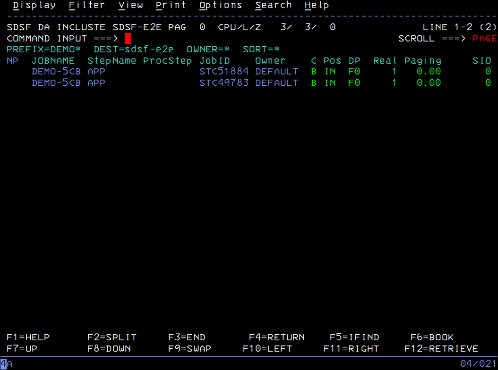

- Kwirth: https://kwirthmagnify.dev — source at https://github.com/kwirthmagnify/kwirth
- Plugin source: https://github.com/jfvilas/kwirth (folder `plugins/sdsf`)
- License: MIT. The 3270 font is [rbanffy/3270font](https://github.com/rbanffy/3270font) (BSD-3-Clause,
  `LICENSE-3270font.txt`), embedded in the bundle.

## What it is

| SDSF / z/OS | Kubernetes |
|---|---|
| System | The cluster picked in Kwirth's cluster list |
| Address space / job (JOBNAME) | Pod |
| StepName / ProcStep | Container / init container |
| JobID (`STC12345`, `JOB12345`, `TSU12345`) | Stable id from the pod uid; JOB for Jobs, TSU for bare pods, STC for the rest |
| Owner | Service account |
| C (class) | QoS class: G, B or E |
| Pos | IN (ready), LO (running, not ready), NS (pending), END, ABN, TRM (terminating) |
| DP | Priority, in hex: FF/FE for the system-critical classes |
| Real / CPU% | Memory (MiB) and CPU, from Kwirth's `metrics` provider |
| SIO | Restarts |
| DEST | Namespace |
| SYSOUT (`S`) | Container log, in a browse |
| Job data sets (`?`) | The pod's containers |
| Cancel (`C` / `CA`) | Delete the pod (CA: grace period 0), always confirmed |
| Batch jobs (`ST`, `O`, `H`) | Jobs and CronJobs; queue EXECUTION (running), PRINT (ended), INPUT (CronJob waiting for its time), HOLD (CronJob suspended) |

The screen behaves like a real 3270: **block mode** (nothing moves until you press an AID key),
protected and unprotected fields, the 3270 base colours, insert mode, and the OIA status line under
the last row with the keyboard lock (`X SYSTEM`) and the cursor position.

## The terminal

Starting the channel asks which terminal SDSF runs on:

| Model | Screen |
|---|---|
| 3278-2 | 24 rows of 80 columns |
| 3278-3 | 32 rows of 80 columns (the default) |
| 3278-5 | 27 rows of 132 columns |

and the display: **Colour (3279)**, the seven 3270 colours, or **Green phosphor (3278)**, a monochrome
3278 that has no colours, only normal and intensified green. What SDSF asks for in colour reaches it as
intensity, as ISPF does: white, red, yellow and intensified fields are bright, the rest normal.

The panels lay themselves out in the model's size: more rows of data on a taller screen, more columns of
the DA and ST before PF11 on a wider one, and a 131-column browse on the 27x132. The choice is saved with
the tab; to change it, stop the channel and start it again — a new session, as a new logon.

## Using it

Open SDSF with the **cluster** view on the cluster you want, start it, and you are on the primary
option menu. `DA` lists the pods.

**Primary commands** (on `COMMAND INPUT ===>`):

| Command | Does |
|---|---|
| `DA` | Active pods: every pod but the DaemonSets and the ended ones |
| `DA OJOB` · `DA NOTSU` · `DA ALL` … | The DA parameters of z/OS, up to four: types `JOB` (pods of a Job), `STC` (other owners), `TSU` (bare pods), `INIT` (DaemonSets); positions `IN` (ready), `OUT` (pending, no node), `READY` (pending on a node), `TRANS` (not ready or terminating). `O…` only that one, `NO…` not that one, `ALL`/`ALLT`/`ALLP` everything, all types, all positions (with the ended pods) |
| `ST` | Jobs and CronJobs as batch jobs, with their JES queue (EXECUTION, PRINT, INPUT, HOLD) and status |
| `O` · `H` | Only the ended Jobs (output queue) · only the suspended CronJobs (held output) |
| `INIT` | The nodes as initiators: ACTIVE, HALTED (cordoned, with pods), DRAINED (cordoned and empty) or INACTIVE (not Ready), with their roles, pods, CPU and memory |
| `LOG` | The cluster's events as the SYSLOG, newest at the bottom; Enter reads again and follows the log when you are at the bottom |
| `PREFIX api*` · `OWNER sa*` | Filter by pod name or service account; `*` any string, `%` one character; `*` alone resets |
| `DEST kube-system` · `DEST (ALL)` | One namespace, or all |
| `SORT col [A\|D]` | Sort by any column (`SORT sio d`); `SORT` alone goes back to the natural order |
| `FIND text` · `RFIND` (PF5) | Find in the rows, or in a browse |
| `TOP` · `BOTTOM` · `UP n` · `DOWN n` · `LEFT` · `RIGHT` | Scroll; PF7/PF8 and PF10/PF11 do it with the SCROLL amount (PAGE, HALF, DATA, CSR, MAX or a number) — `M` + PF8 goes to the end |
| `&nn` · `&` | Refresh every nn seconds; stop it (PA1 stops it too) |
| `RETRIEVE` (PF12) | The commands typed before |
| `END` (PF3) · `RETURN` (PF4) | Back; END on the menu leaves to TSO `READY` (type `SDSF` to come back) |

**Line commands** (in the `NP` column of a row, then Enter):

| Command | Does |
|---|---|
| `S` | Browse the log of the main container (on a Job, of its newest pod; on a CronJob, of its last run) |
| `?` | List the containers; `S` on one browses its log |
| `D` | Browse the pod, Job or CronJob described, with its events |
| `C` · `CA` | Cancel (delete) the pod, Job or CronJob (with its pods), after a confirmation window; CA with no grace period |

On **INIT**, as on SDSF's initiator panel:

| Command | Does |
|---|---|
| `S` | Start the node: uncordon it |
| `Z` | Halt it: cordon, so no new pods go there; the running ones stay |
| `P` | Drain it: cordon, then evict every pod but the DaemonSet and static ones (PodDisruptionBudgets apply; the evictions refused are reported) |
| `D` | Browse the node described, with its pods and events |
| `?` | The DA of the node's pods; PF3 comes back to INIT |

`S`, `Z` and `P` need the `admin` scope and always ask first.

Several line commands in one Enter run as SDSF runs them: the cancels together through one
confirmation, then the rest one after the other, each when PF3 comes back from the previous one.

## Keyboard

Laid out as PCOMM and x3270 do on a PC keyboard:

| 3270 key | PC key |
|---|---|
| **Enter** (sends the screen) | **Right Ctrl** |
| Newline | Intro / Enter |
| Reset | Left Ctrl |
| Clear | Esc |
| PF1–PF12 / PF13–PF24 | F1–F12 / Shift+F1–F12 |
| PF7 / PF8 | also PgUp / PgDn |
| PA1 / PA2 / PA3 | Alt+1 / Alt+2 / Alt+3 (on Chrome for Linux Alt+1..3 switch browser tabs and never reach the page: stop an `&nn` with `&` + Enter instead) |
| Erase EOF | End |
| Insert mode | Insert |

The two Ctrl keys act only when pressed and released on their own, so Ctrl+C and Kwirth's
Ctrl+Shift+Enter (full screen) keep working. In full screen the terminal takes the whole window.

## Installing it in Kwirth

It is published on npmjs as `@jfvilas/kwirth-plugin-sdsf` and listed in the jfvilas marketplace. If
your Kwirth does not list it yet, add it as a marketplace with this manifest URL:

```
https://raw.githubusercontent.com/jfvilas/kwirth/master/manifest.json
```

Then install `sdsf` from the plugin manager. No restart is needed. It **uses** Kwirth's `metrics`
provider for the `Real` and `CPU%` columns when it is installed; without it SDSF works the same and
says the metrics are not available.

## Permissions

| Scope | Allows |
|---|---|
| `sdsf$read` | Open SDSF, list pods, Jobs, CronJobs and nodes, browse logs, describe them |
| `sdsf$cancel` | Also cancel (delete) pods, Jobs and CronJobs |

`cluster` and `admin` reach everything, and only `admin` starts, halts or drains a node. Pods are always
limited to the namespaces and pods the access key covers — the Pods count of a node too.

## Screenshots

The primary option menu:

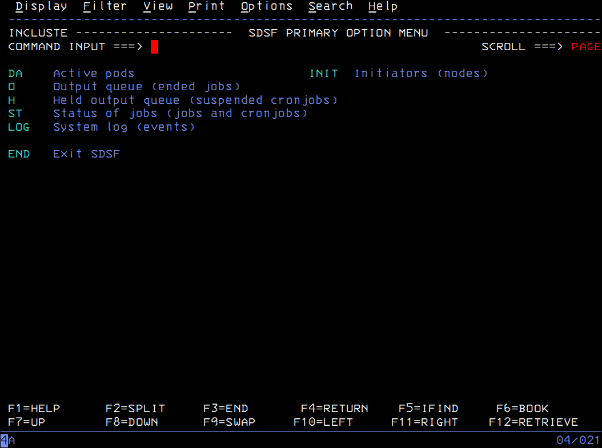

A container log, with `S`:

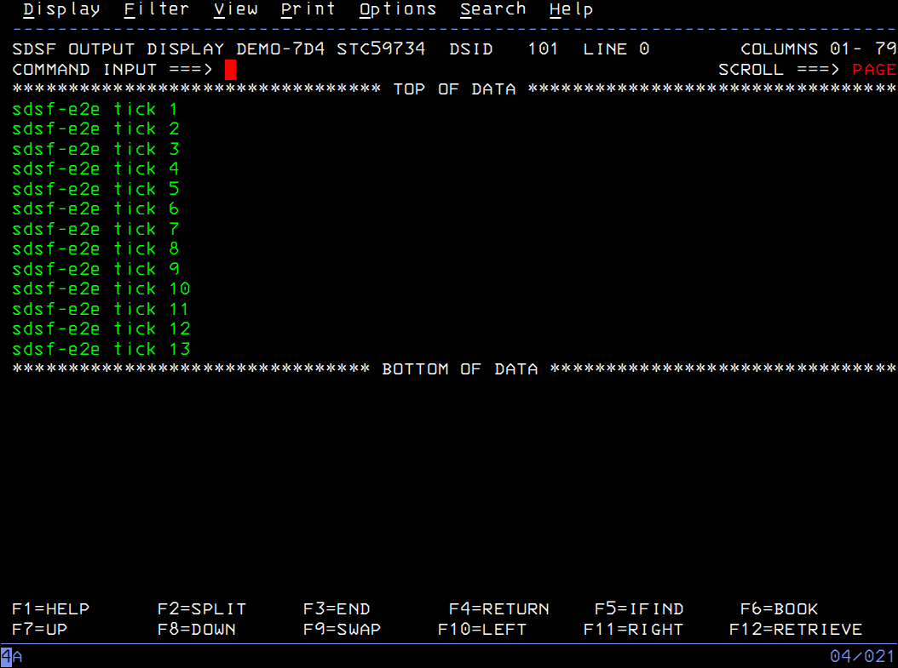

The pod's containers, with `?`:

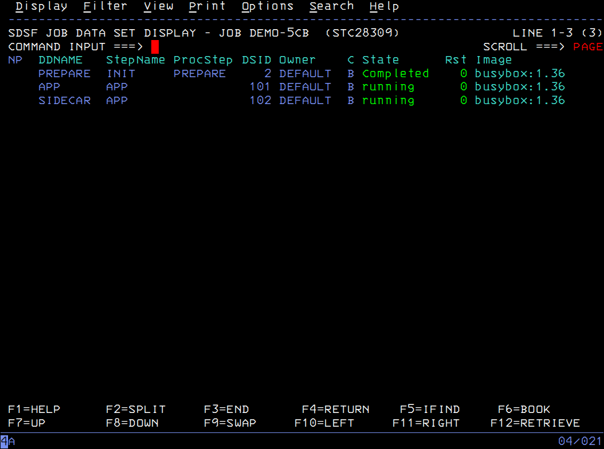

The cluster's events as the SYSLOG, with `LOG` (warnings in yellow, failures in red):

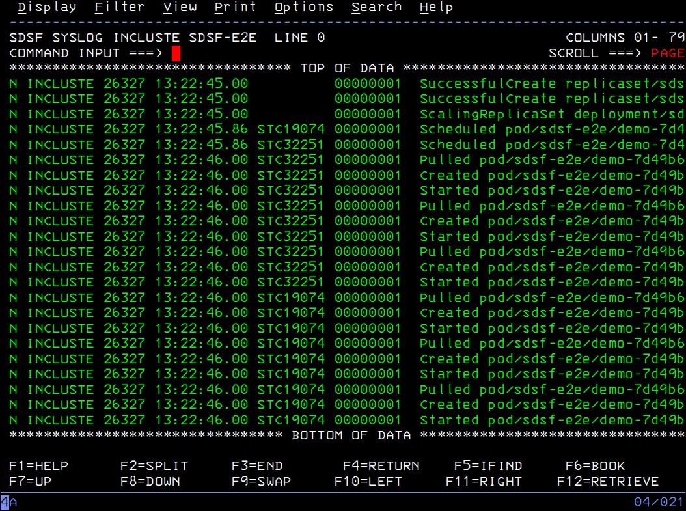

Jobs and CronJobs, with `ST`:

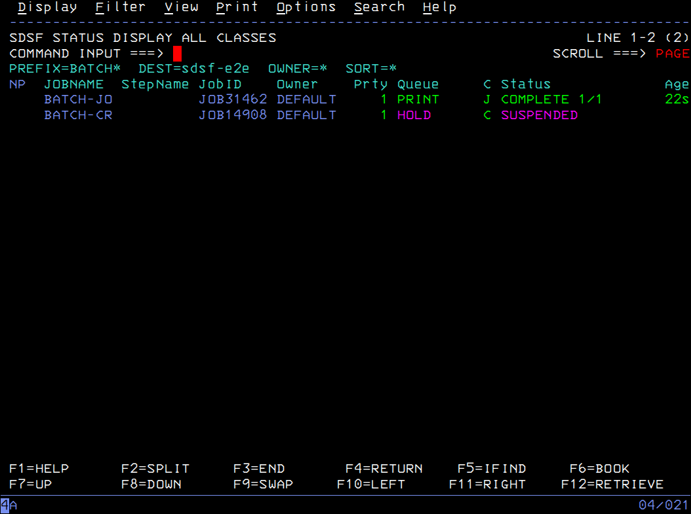

The nodes as initiators, with `INIT`:

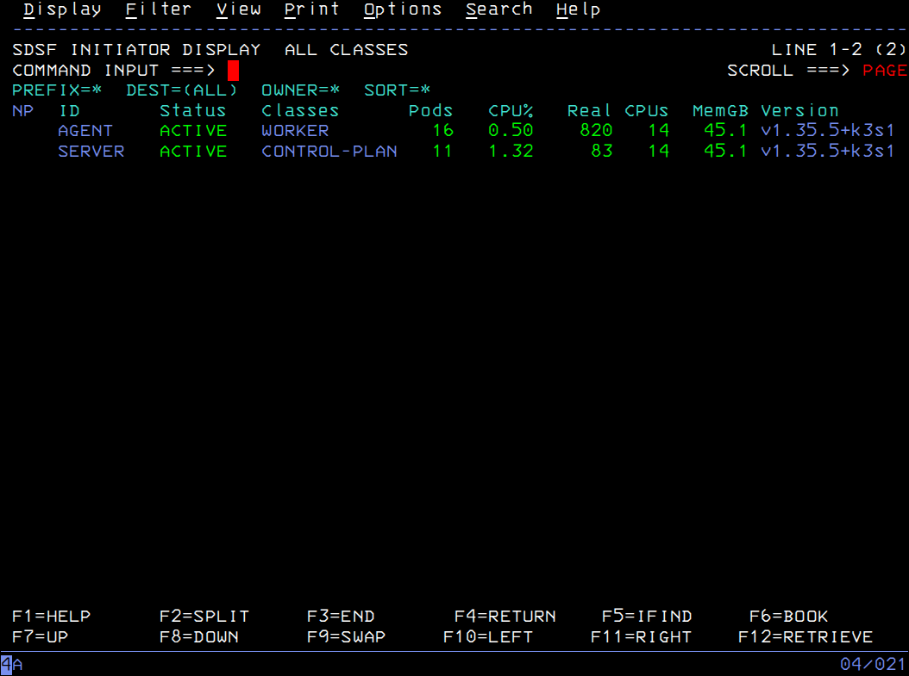

Cancelling a pod, with `C`:

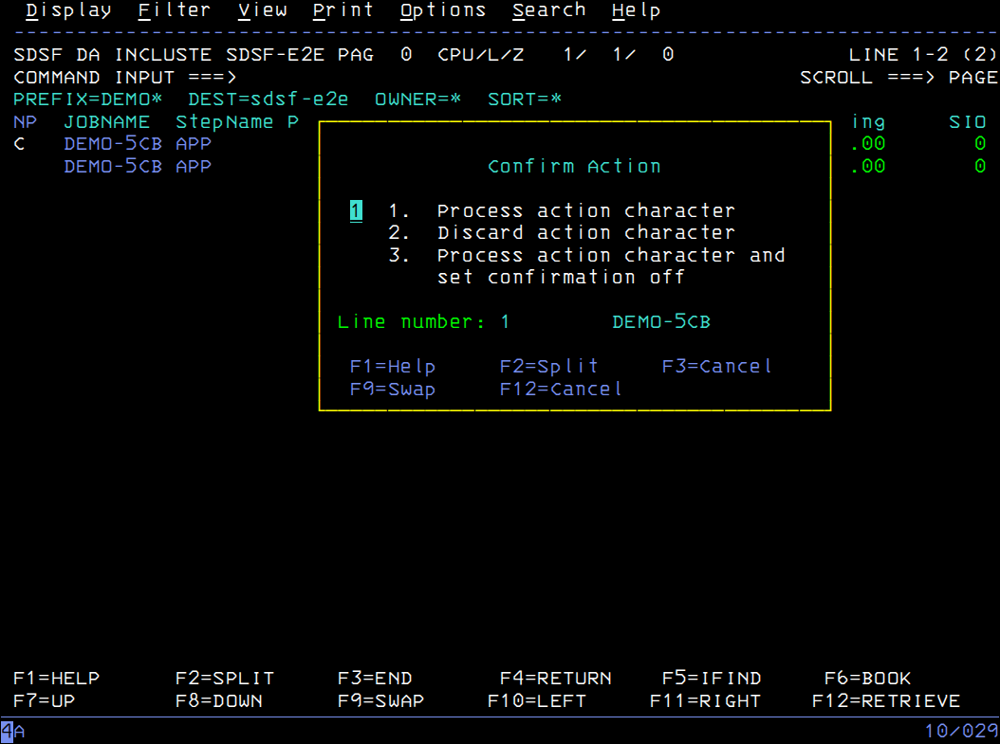

A 3278-2 in green phosphor:

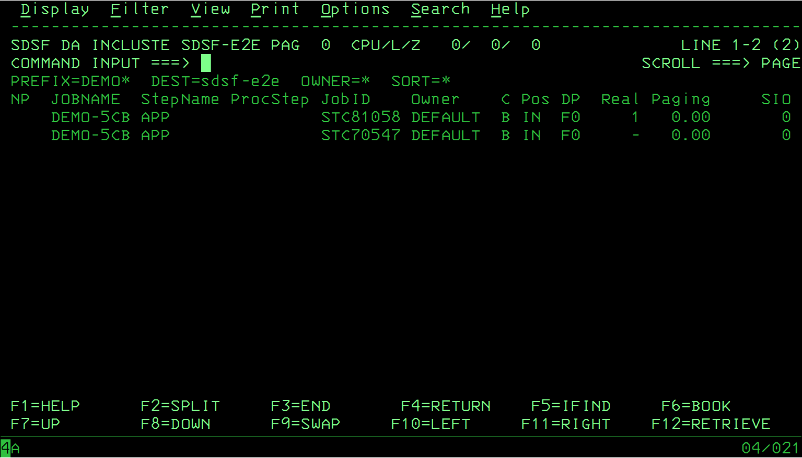

A 3278-5, 27x132, where the DA shows its CPU% and Status columns without PF11:

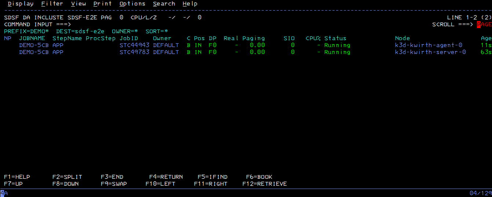

Full screen, with the OIA under the last row:

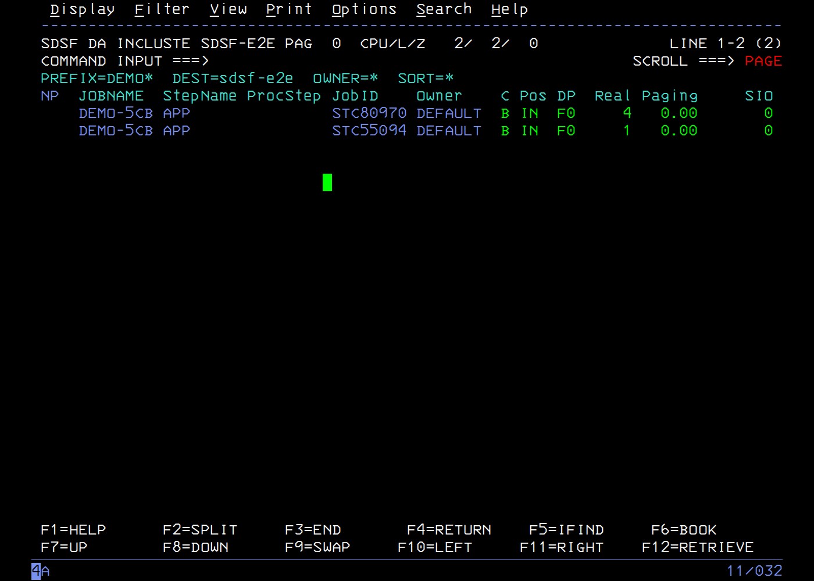

## Building

```
npm install --legacy-peer-deps
npm run build      # typecheck + dist/
npm test           # unit tests; COVERAGE=1 npm test for c8 coverage
```

The e2e (`e2e/`, Playwright) runs against a live Kwirth with its own `.creds.json`; it creates the
`sdsf-e2e` namespace and deletes it at the end.
