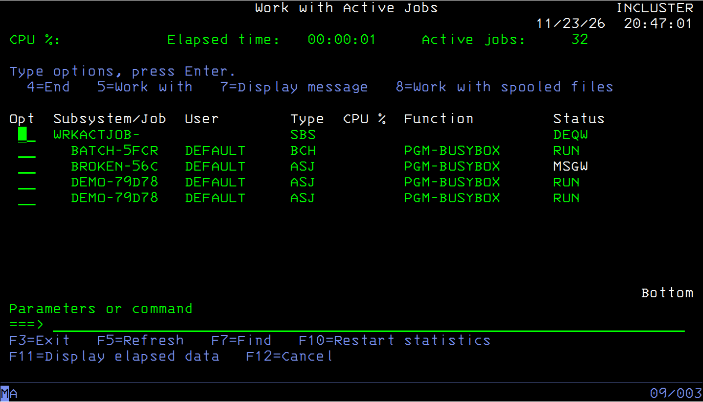
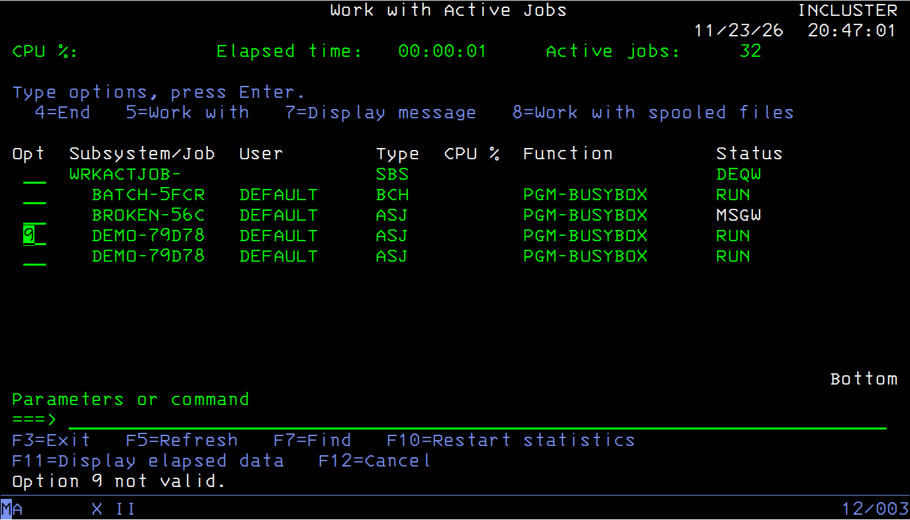
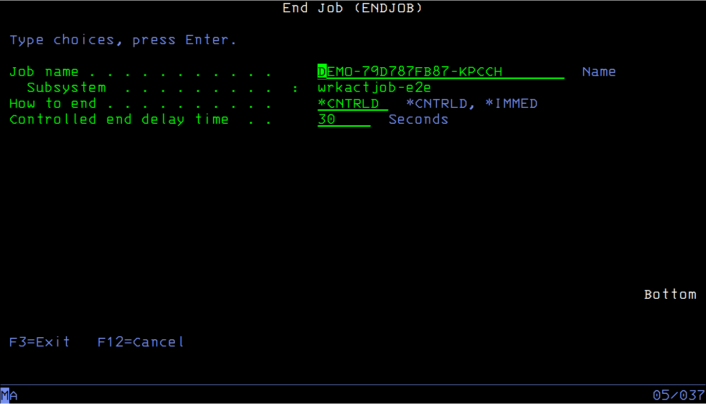
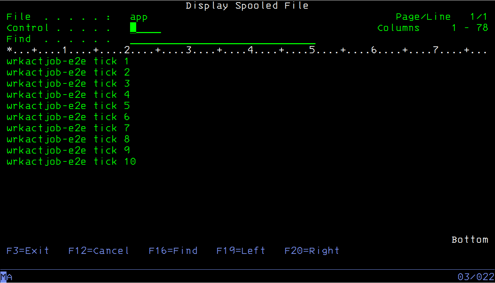
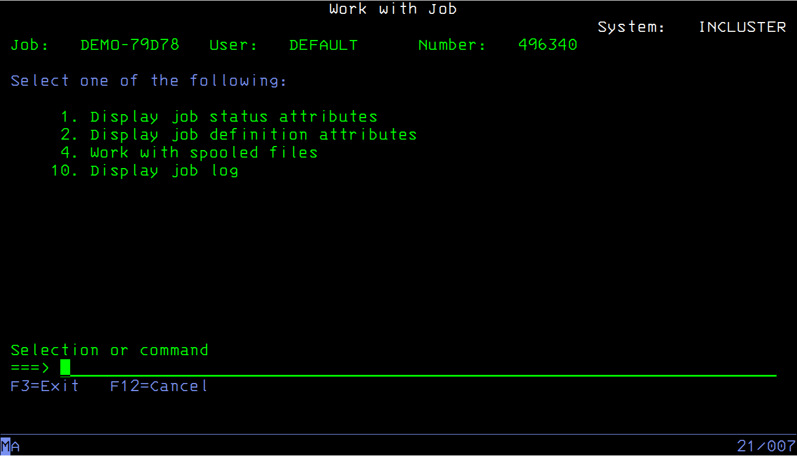
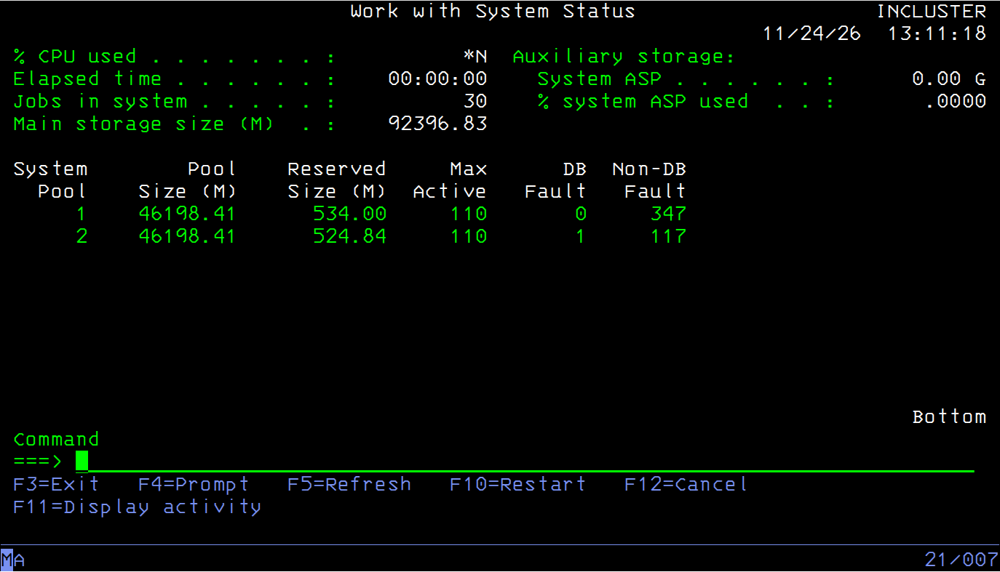
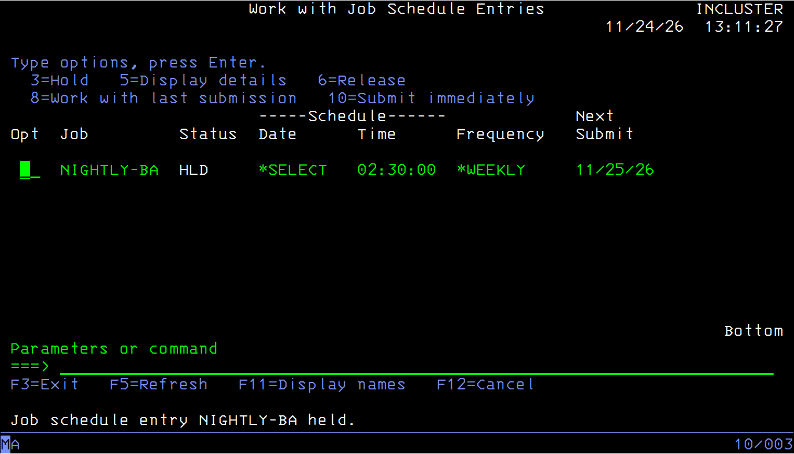
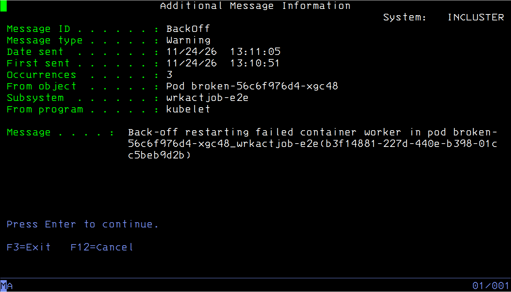
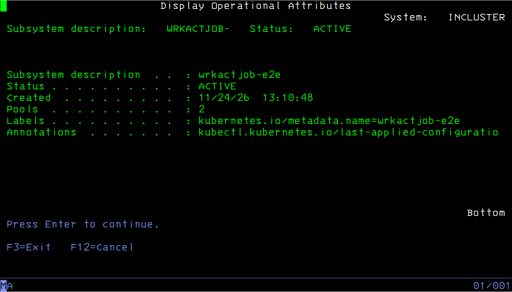
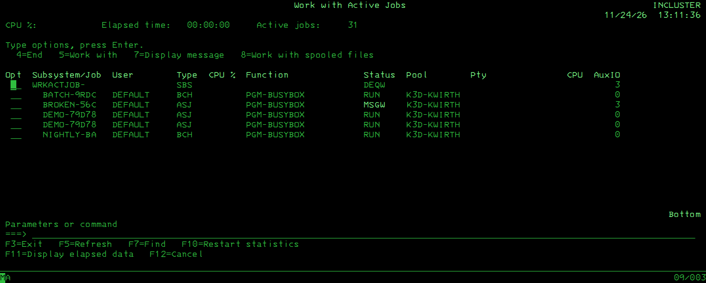

# WRKACTJOB — a channel plugin for Kwirth

IBM i (AS/400) **Work with Active Jobs** on a 5250 terminal (24x80 or 27x132, in colour or green screen),
inside a [Kwirth](https://kwirthmagnify.dev) tab — except that what it lists are **pods**, grouped by
**namespace** as jobs are grouped by subsystem. Put `4` in front of a job to end it, `5` to work with it, `8` to
read its spooled files (its containers' logs), and press F5 to refresh. From the Main Menu, the rest of an
operator's day: `WRKSYSSTS` (nodes as storage pools), `WRKSBS`, `DSPMSG QSYSOPR` (the cluster's warnings) and
`WRKJOBSCDE` (CronJobs as job schedule entries, to hold, release and submit).



- Kwirth: https://kwirthmagnify.dev — source at https://github.com/kwirthmagnify/kwirth
- Plugin source: https://github.com/jfvilas/kwirth (folder `plugins/wrkactjob`)
- License: MIT.
- The 5250 terminal (engine, screen, keyboard and font) comes from the **Block Terminal** DCE,
  `@jfvilas/kwirth-dce-blockterm` ([`dces/blockterm`](https://github.com/jfvilas/kwirth/tree/master/dces/blockterm)),
  which WRKACTJOB requires. It is the same terminal as the SDSF plugin's.

## IBM i → Kubernetes

| IBM i | Kubernetes |
|---|---|
| System name | The cluster picked in Kwirth's cluster list |
| Subsystem (`SBS`) | Namespace |
| Job | Pod |
| User | Service account |
| Type `ASJ` / `BCH` / `SYS` / `BCI` | Pod of a Deployment or StatefulSet / of a Job / of a DaemonSet / a bare pod |
| Status `RUN` / `DEQW` | Running, with / without CPU in the last interval |
| Status `SCDW` | Pending |
| Status `MSGW` | A container failing (CrashLoopBackOff, ImagePullBackOff, OOMKilled…): `7` shows why |
| Status `END` | Being deleted |
| Function `PGM-…` | The main container's image |
| `ENDJOB OPTION(*CNTRLD) DELAY(n)` / `*IMMED` | Delete the pod with grace period n / 0 |
| Spooled files | Containers; `DSPSPLF` shows the log |
| Job log | The pod's events |

CPU figures come from Kwirth's `metrics` provider when it is installed; without it WRKACTJOB works the same,
with no CPU figures.

## The terminal

When the channel starts it asks for the terminal: a **3179-2 (24x80)** or a **3477-FC (27x132)**, in
**colour** or as a **green monochrome 5251**. It is a new session each time, so changing it is stopping and
starting the channel. At 132 columns the first view shows the elapsed data too.

It is a 5250 in block mode: nothing reaches Kwirth until you press an attention key, and the keyboard waits
(`X SYSTEM` in the status line) until the answer is painted. The keyboard is PCOMM's:

| 5250 key | PC key |
|---|---|
| Enter | **Right Ctrl** |
| Reset (frees the keyboard after an error, `X II`) | **Left Ctrl** |
| Field Exit | Intro |
| Field+ / Field- | Numpad + / - |
| F1–F12 / F13–F24 | F1–F12 / Shift+F1–F12 |
| Roll Up / Roll Down | PgDn / PgUp |
| Erase EOF / Erase Input | End / Alt+End |

## WRKACTJOB

It opens on **Work with Active Jobs**: every subsystem (namespace) with its jobs (pods) under it.

| Key or command | Does |
|---|---|
| F5 or Enter | Refresh the list |
| F10 | Restart the statistics (elapsed time) |
| F11 | Next view: status, elapsed data (pool, priority, CPU, restarts), full Kubernetes names |
| F7 | Find the text typed on the command line, from the first row shown on |
| PgDn / PgUp | Next / previous page |
| F3 | The Main Menu (`1` back to WRKACTJOB, `90` or F3 to sign off) |
| F12 | Back to the panel WRKACTJOB was called from (`8` on WRKSBS, or WRKACTJOB typed on another panel); else the Main Menu |
| `WRKACTJOB SBS(name) JOB(API*)` | Only that subsystem, only the jobs starting with API |
| `SIGNOFF` | End the session; Enter signs on again |
| `WRKJOB JOB(name)` | Work with that job |
| `ENDJOB JOB(name) OPTION(*CNTRLD\|*IMMED) DELAY(n)` | End that job; F4 on it opens its prompt |

Options, typed in `Opt` (several at once run in order, top to bottom):

| Option | Does |
|---|---|
| `4` End | The **End Job (ENDJOB)** prompt: `*CNTRLD` gives the pod DELAY seconds (its grace period), `*IMMED` none |
| `5` Work with | **Work with Job**: 1 status attributes, 2 definition attributes, 4 spooled files, 10 job log (the pod's events) |
| `7` Display message | Why a job in `MSGW` is failing |
| `8` Work with spooled files | The containers; `5` on one shows its log (**Display Spooled File**: Control `T`/`B`/`+n`/`-n`, Find with F16, F19/F20 to shift) |

In every job panel F12 goes back one panel and F3 back to the list.

## More IBM i commands

From the Main Menu (its number) or any command line. F4 on any of them runs it. In each, F12 goes back one panel
and F3 back to where it was called from.

| Menu | Command | What it shows |
|---|---|---|
| 2 | `WRKSBS` | **Work with Subsystems**: every namespace with the memory its pods ask for (*Total Storage*) and the pools (nodes) they run on, numbered as `WRKSYSSTS` numbers them. F11: status, jobs and the full name. F14: `WRKSYSSTS` |
| 3 | `DSPMSG QSYSOPR` (or `DSPMSG`, `WRKMSG`) | **Display Messages** of the system operator: the cluster's Warning events, newest first. F1 on one: **Additional Message Information**, the whole event. Nothing to reply to: Enter leaves |
| 4 | `WRKSYSSTS` | **Work with System Status**: % CPU used, jobs in the system, main storage (the nodes' memory) and the system ASP (the PersistentVolumes); then one **pool per node**: its size, the memory reserved by its pods, max active (pods it takes), *DB Fault* (jobs in `MSGW`) and *Non-DB Fault* (restarts). F11: activity (jobs, CPU %, memory used) and the node names. F10 or `RESET(*YES)` restarts the elapsed time |
| 5 | `WRKJOBSCDE` | **Work with Job Schedule Entries**: the CronJobs, `SCD` or held (`HLD`, suspended), with the schedule in IBM i's words when it has them — `*ALL 02:00:00 *WEEKLY` is every day at two, `*MON` or `*SELECT` some days, `*MONTHLY` one day of the month — or `*CRON` and the expression; and the next submit date, in the CronJob's time zone. F11: the subsystem, the full name and the cron |

Options on `WRKSBS`:

| Option | Does |
|---|---|
| `5` Display subsystem description | **DSPSBSD** (also `DSPSBSD SBSD(name)`): 1 operational attributes (status, creation, labels, annotations), 2 pool definitions, 3 resource quota entries, 4 limit range entries |
| `8` Work with subsystem jobs | `WRKACTJOB SBS(it)`; F12 there comes back to `WRKSBS` |

Options on `WRKJOBSCDE`:

| Option | Does |
|---|---|
| `3` Hold | The **HLDJOBSCDE** prompt; Enter suspends the CronJob |
| `5` Display details | The schedule as cron and in words, the time zone, the next submit, and its submissions (its Jobs) |
| `6` Release | The **RLSJOBSCDE** prompt; Enter resumes it |
| `8` Work with last submission | `WRKACTJOB` with the pods of its last Job |
| `10` Submit immediately | The **SBMJOB** prompt; Enter runs it now, as `kubectl create job --from=cronjob/…` does |

There is no `4` on either: ending a subsystem would delete a namespace or stop everything in it, and removing a
schedule entry deletes a CronJob — neither is an operator's everyday action, so they are not here.

## Installing it in Kwirth

It is published on npmjs as `@jfvilas/kwirth-plugin-wrkactjob` and listed in the jfvilas marketplace. If your
Kwirth does not list it yet, add it as a marketplace with this manifest URL:

```
https://raw.githubusercontent.com/jfvilas/kwirth/master/manifest.json
```

WRKACTJOB **requires** the `blockterm` DCE (Block Terminal, **0.2.0 or later**: the one with the 5250), from the
same marketplace: install it first from the DCE manager and restart the Kwirth back end, as every DCE needs.
Kwirth will not install WRKACTJOB without it.

Then install `wrkactjob` from the plugin manager. No restart is needed. It **uses** Kwirth's `metrics` provider
for the CPU figures when it is installed; without it WRKACTJOB works the same, says the metrics are not
available, and shows every running job as `RUN`.

## Permissions

| Scope | Allows |
|---|---|
| `wrkactjob$read` | Open WRKACTJOB, list the active jobs, read their spooled files and job log; every other panel, to look |
| `wrkactjob$schedule` | Hold, release and submit job schedule entries (`WRKJOBSCDE` 3, 6 and 10): suspend, resume and run CronJobs. Deletes nothing |
| `wrkactjob$end` | End jobs (option 4, `ENDJOB`): delete pods. Includes `wrkactjob$schedule` |

What a key sees is limited, as everywhere in Kwirth, by the namespaces and pods it reaches: a CronJob is matched
by its name against the key's pod patterns (its pods are named after it), and a subsystem shows when the key
reaches it or a job in it. Nodes and volumes are the cluster's: below the `cluster` scope, `WRKSYSSTS` shows `*N`
for them and no pools, and `DSPMSG` leaves out the nodes' messages.

## Screenshots

An option not valid: the message on the error line, the keyboard locked (`X II`) until Reset:



F11, the third view: the subsystem's and the jobs' full Kubernetes names:


`7` on a job in `MSGW`, and `4`, the End Job prompt:




`8`, the containers as spooled files, and `5` on one, its log:




`5`, Work with Job, and the Main Menu with the commands of the other panels:




`WRKSYSSTS`, a pool per node:



`WRKJOBSCDE`, a CronJob held again after `6` and `3`:



`DSPMSG QSYSOPR`, F1 on the failing job's message, and `5` on `WRKSBS`, the subsystem's attributes:





A 3477-FC at 27x132 as a green 5251, the elapsed data beside the status:



## Building

```
npm install --legacy-peer-deps
npm run build      # typecheck + dist/
npm test           # unit tests; COVERAGE=1 npm test for c8 coverage
```

The e2e (`e2e/`, Playwright) runs against a live Kwirth with its own `.creds.json`; it creates the
`wrkactjob-e2e` namespace (with a suspended CronJob of its own, the only one it holds, releases and submits)
and deletes it at the end. Its job lists only show that subsystem; the system panels (`WRKSYSSTS`, `WRKSBS`,
`DSPMSG`) read the whole cluster, so their captures are taken where only the fixture shows.
