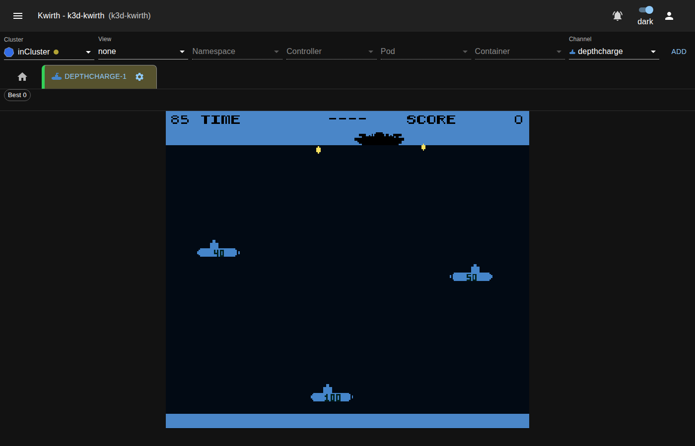
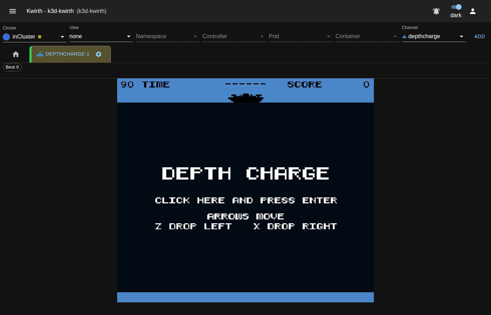
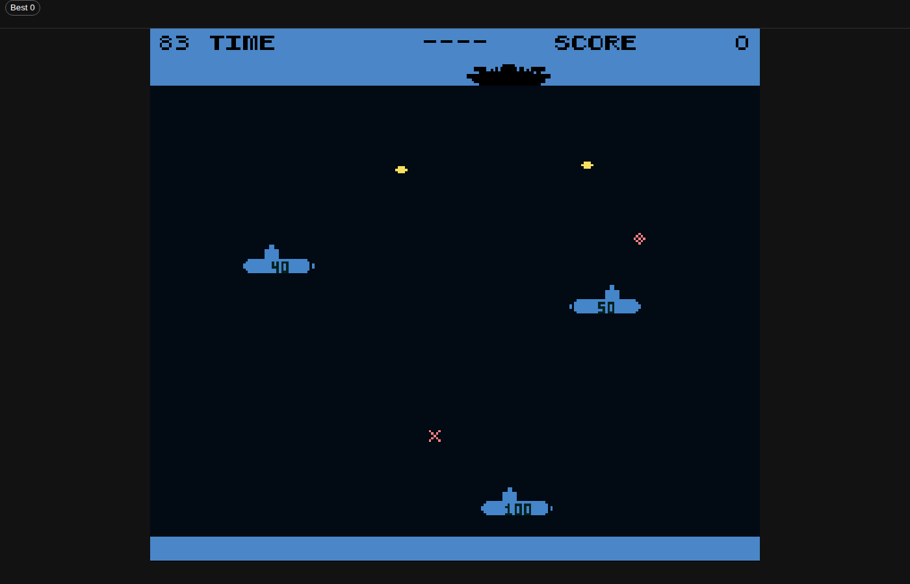

# Depth Charge — a channel plugin for Kwirth

A retro destroyer-versus-submarines arcade game inside a [Kwirth](https://kwirthmagnify.dev) tab. Sail your
destroyer along the surface and drop depth charges on the submarines patrolling below: the deeper the
submarine, the more it is worth, and the clock is running.



- Kwirth: https://kwirthmagnify.dev — source at https://github.com/kwirthmagnify/kwirth
- Plugin source: https://github.com/jfvilas/kwirth (folder `plugins/depthcharge`)
- npm: `@jfvilas/kwirth-plugin-depthcharge`

## What it is

A **standalone channel**: it reads nothing of the cluster, asks for no cluster scope and selects no pods.
Picking it switches the view to `none` on its own. The game runs entirely in your browser, drawn on a canvas;
the back end only registers the channel instance so Kwirth can pause and stop it.

The game **survives tab switches**: it lives in the channel's data, outside React's render tree, and the tab
only holds the canvas and the keyboard. It has no setup: Start starts it.

## Using it

Add the **depthcharge** channel to a tab and start it. The top band shows the time left, your charges and
the score; each submarine carries its value on its hull. The bar above the game shows the best score.

The tab has to have the focus (click it): the keys never leave it, so other tabs and Kwirth itself keep
theirs.

| Key | Action |
|---|---|
| ← / A | Move left |
| → / D | Move right |
| Z / Q | Drop a depth charge on the left side |
| X / E | Drop a depth charge on the right side |
| Enter / Space | Start a game |
| Ctrl+Shift+Enter | Kwirth's full screen |

## Installing it in Kwirth

It is published on npmjs as `@jfvilas/kwirth-plugin-depthcharge` and listed in the jfvilas marketplace. If
your Kwirth does not list it yet, add it as a marketplace with this manifest URL:

```
https://raw.githubusercontent.com/jfvilas/kwirth/master/manifest.json
```

Then install `depthcharge` from the plugin manager. No restart is needed and it depends on no other
extension. You can also install it from a local `.tgz` with **Browse…**.

## Screenshots

The title screen:



Full screen:



## Building

```
npm install
npm run build        # dist/: front.js, back.js, package.json, README.md
```

The e2e (`e2e/`, Playwright) runs against a live Kwirth with its own `.creds.json`;
`tests/zz-readme.spec.ts` takes the screenshots of this README.
