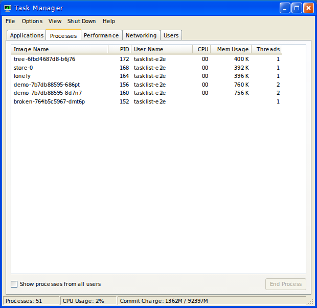
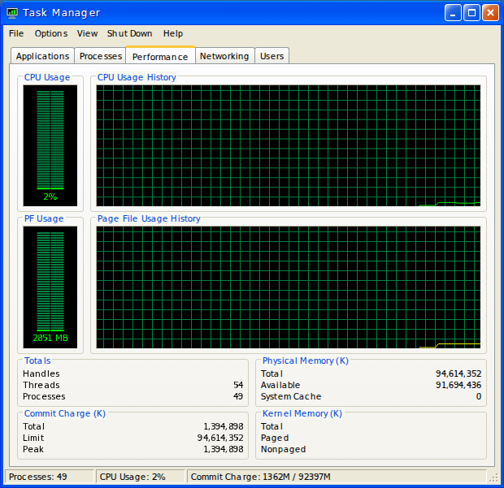
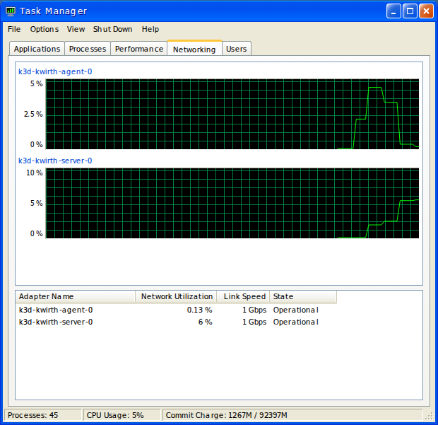
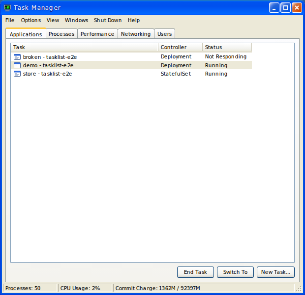
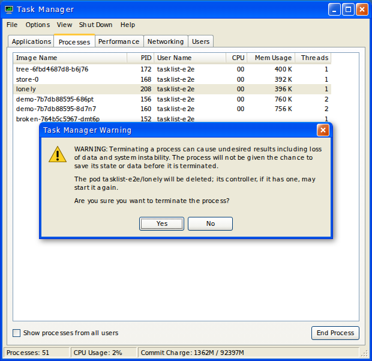
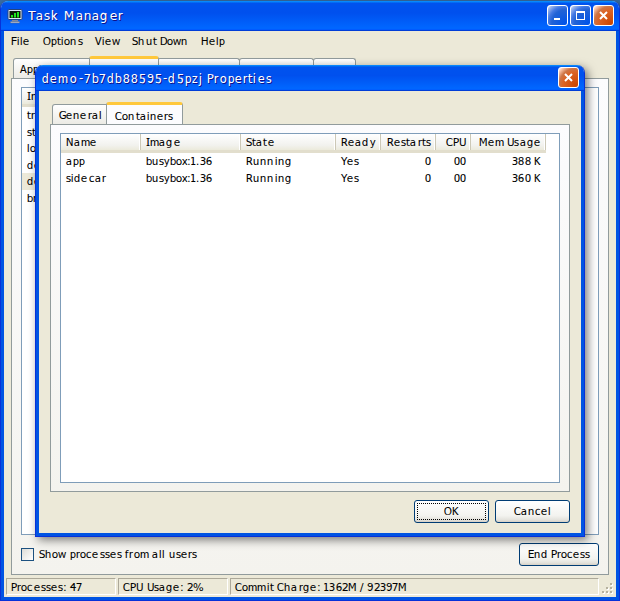
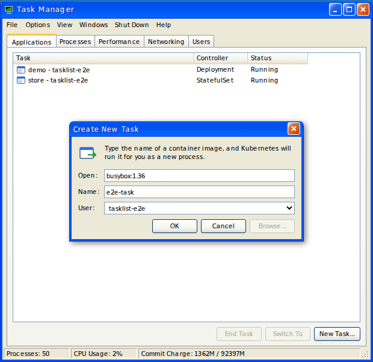

# Task Manager — a channel plugin for Kwirth

The classic XP **Task Manager** window, blue title bar and all, inside a [Kwirth](https://kwirthmagnify.dev) tab —
except that the computer it manages is a **Kubernetes cluster**. Its processes are **pods**, its applications
**Deployments**, its CPUs and network adapters the **nodes**, and its users the **namespaces**. Sort the processes
by CPU, select one and press `End Process`; watch the cluster breathe on the Performance tab.



- Kwirth: https://kwirthmagnify.dev — source at https://github.com/kwirthmagnify/kwirth
- Plugin source: https://github.com/jfvilas/kwirth (folder `plugins/tasklist`)
- License: MIT. The window is drawn from scratch in CSS with its own icons: no image, icon or font of Microsoft's is
  used, and the plugin is not affiliated with Microsoft. The font is Wine's Tahoma replacement (LGPL-2.1, see
  `src/front/fonts/LICENSE-wine-tahoma.txt`).

## XP → Kubernetes

| Task Manager | Kubernetes |
|---|---|
| The computer | The cluster picked in Kwirth's cluster list |
| Process (`Image Name`) | Pod |
| `PID` | A number given to each pod while the channel is open (a multiple of 4, as Windows does) |
| `User Name` | Namespace |
| `CPU` | The pod's share of the whole cluster's CPU |
| `Mem Usage` / `Peak Mem Usage` | The pod's working set / the highest seen |
| `Threads` | Containers |
| `System Idle Process` | What the cluster's CPU is not doing |
| `Show processes from all users` | Unchecked hides the system's users: the `kube-*` namespaces |
| Application (`Task`) | Deployment — `Not Responding` while fewer replicas are ready than wanted |
| CPU (`One Graph Per CPU`) | Node |
| `PF Usage` / Page File history | Memory in use in the cluster |
| `Physical Memory` (Total / Available / System Cache) | Nodes' capacity / capacity not in use / capacity not allocatable |
| `Commit Charge` (Total / Limit / Peak) | Memory requested by the pods / nodes' allocatable / highest requested |
| Network adapter | A node's default interface, at a nominal 1 Gbps (the kubelet does not give the real speed) |
| User (`Users` tab) | Namespace; `Session` is how many pods it runs |

`Handles` and `Kernel Memory` have no equivalent and stay empty.

CPU, memory and network figures come from Kwirth's `metrics` provider when it is installed; without it the window
works the same, with no figures.

## What you can do

| Where | What | In Kubernetes |
|---|---|---|
| Processes | `End Process` (or Delete) | Deletes the pod; its controller, if it has one, starts another |
| Processes | `End Process Tree` | Deletes the pod's controller (its Deployment, StatefulSet, DaemonSet or Job), and its pods with it |
| Processes | `Properties` | The pod: user, computer (node), parent, and its containers |
| Processes | `View → Select Columns...` | PID, CPU Time, Peak Mem Usage, Threads, I/O Read and Write Bytes |
| Applications | `End Task` | Deletes the Deployment |
| Applications | `Switch To` / `Go To Process` | The Processes tab with the application's pods selected |
| Applications, File | `New Task...` | Creates a pod from an image (`kubectl run`), in the namespace you choose |
| Users | `Logoff` | Deletes the namespace — everything in it |
| Shut Down | `Stand By` / `Turn Off` / `Restart` | Cordons / drains / uncordons the node you choose |
| View | `Update Speed`, `Refresh Now` | Refresh every 1, 2 or 4 seconds, or paused |

Everything that ends something asks first, with XP's warning. The headers sort the lists (a second click turns the
order round) and resize by their edge; the window remembers its tab, columns, widths and selection while the
channel is open, and Maximize fills the Kwirth tab.

## Installing it in Kwirth

It is published on npmjs as `@jfvilas/kwirth-plugin-tasklist` and listed in the jfvilas marketplace. If your
Kwirth does not list it yet, add it as a marketplace with this manifest URL:

```
https://raw.githubusercontent.com/jfvilas/kwirth/master/manifest.json
```

Then install `tasklist` from the plugin manager. No restart is needed. It **uses** Kwirth's `metrics` provider for
the figures when it is installed.

## Permissions

| Scope | Allows |
|---|---|
| `tasklist$read` | Open the Task Manager and see everything in it |
| `tasklist$end` | End processes, process trees and tasks; run new tasks |
| `admin` | `Logoff` (delete a namespace) and `Shut Down` (cordon, drain, uncordon a node) |

What a key sees is limited, as everywhere in Kwirth, by the namespaces and pods it reaches; a controller is matched
by its name against the key's pod patterns. The nodes are the cluster's: below the `cluster` scope, the
Performance tab shows the key's own processes and the Networking tab has no adapters.

## Screenshots

Performance:



Networking, one adapter per node:



Applications, one that answers and one that does not:



End Process:



A process's containers, in its Properties:



Create New Task:



## Building

```
npm install --legacy-peer-deps
npm run build      # typecheck + dist/
npm test           # unit tests; COVERAGE=1 npm test for c8 coverage
```

The e2e (`e2e/`, Playwright) runs against a live Kwirth with its own `.creds.json`; it creates the `tasklist-e2e`
and `tasklist-e2e-logoff` namespaces and deletes them at the end. Everything it ends, creates or logs off is its
own; Shut Down is only opened and cancelled. The Processes, Applications and Users captures show only the
fixture's rows.
