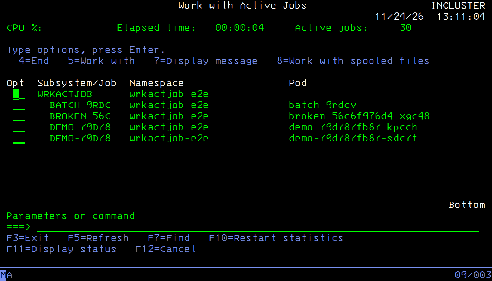
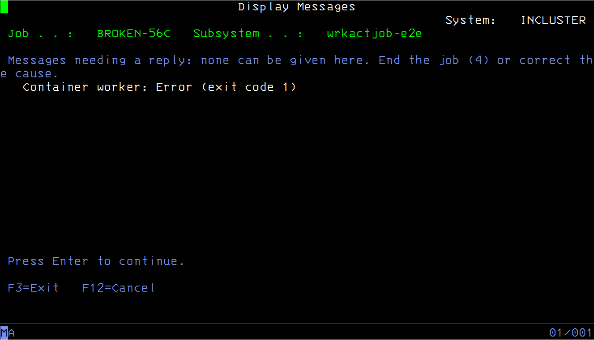
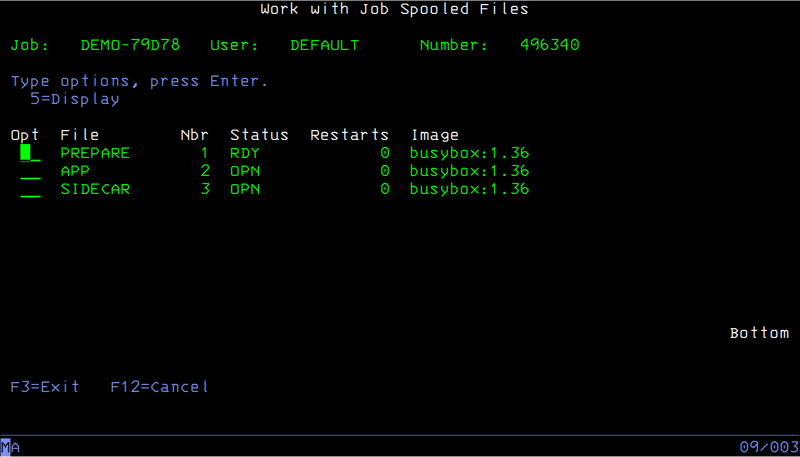
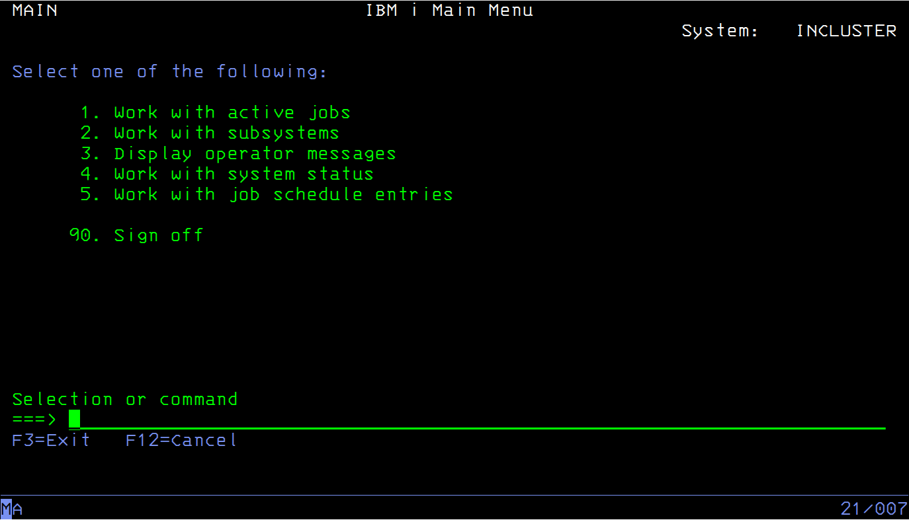

# WRKACTJOB — a channel plugin for Kwirth

IBM i (AS/400) **Work with Active Jobs** on a 5250 terminal (24x80 or 27x132, in colour or green screen),
inside a [Kwirth](https://kwirthmagnify.dev) tab — except that what it lists are **pods**, grouped by
**namespace** as jobs are grouped by subsystem. Put `4` in front of a job to end it, `5` to work with it, `8` to
read its spooled files (its containers' logs), and press F5 to refresh.


- Kwirth: https://kwirthmagnify.dev — source at https://github.com/kwirthmagnify/kwirth
- Plugin source: https://github.com/jfvilas/kwirth (folder `plugins/wrkactjob`)
- License: MIT.
- The 5250 terminal (engine, screen, keyboard and font) comes from the **Block Terminal** DCE,
  `@jfvilas/kwirth-dce-blockterm` ([`dces/blockterm`](https://github.com/jfvilas/kwirth/tree/master/dces/blockterm)),
  which WRKACTJOB requires. It is the same terminal as the SDSF plugin's.

## IBM i → Kubernetes

| IBM i | Kubernetes |
|---|---|
| System name | The cluster picked in Kwirth's cluster list |
| Subsystem (`SBS`) | Namespace |
| Job | Pod |
| User | Service account |
| Type `ASJ` / `BCH` / `SYS` / `BCI` | Pod of a Deployment or StatefulSet / of a Job / of a DaemonSet / a bare pod |
| Status `RUN` / `DEQW` | Running, with / without CPU in the last interval |
| Status `SCDW` | Pending |
| Status `MSGW` | A container failing (CrashLoopBackOff, ImagePullBackOff, OOMKilled…): `7` shows why |
| Status `END` | Being deleted |
| Function `PGM-…` | The main container's image |
| `ENDJOB OPTION(*CNTRLD) DELAY(n)` / `*IMMED` | Delete the pod with grace period n / 0 |
| Spooled files | Containers; `DSPSPLF` shows the log |
| Job log | The pod's events |

CPU figures come from Kwirth's `metrics` provider when it is installed; without it WRKACTJOB works the same,
with no CPU figures.

## The terminal

When the channel starts it asks for the terminal: a **3179-2 (24x80)** or a **3477-FC (27x132)**, in
**colour** or as a **green monochrome 5251**. It is a new session each time, so changing it is stopping and
starting the channel. At 132 columns the first view shows the elapsed data too.

It is a 5250 in block mode: nothing reaches Kwirth until you press an attention key, and the keyboard waits
(`X SYSTEM` in the status line) until the answer is painted. The keyboard is PCOMM's:

| 5250 key | PC key |
|---|---|
| Enter | **Right Ctrl** |
| Reset (frees the keyboard after an error, `X II`) | **Left Ctrl** |
| Field Exit | Intro |
| Field+ / Field- | Numpad + / - |
| F1–F12 / F13–F24 | F1–F12 / Shift+F1–F12 |
| Roll Up / Roll Down | PgDn / PgUp |
| Erase EOF / Erase Input | End / Alt+End |

## WRKACTJOB

It opens on **Work with Active Jobs**: every subsystem (namespace) with its jobs (pods) under it.

| Key or command | Does |
|---|---|
| F5 or Enter | Refresh the list |
| F10 | Restart the statistics (elapsed time) |
| F11 | Next view: status, elapsed data (pool, priority, CPU, restarts), full Kubernetes names |
| F7 | Find the text typed on the command line, from the first row shown on |
| PgDn / PgUp | Next / previous page |
| F3 or F12 | The Main Menu (`1` back to WRKACTJOB, `90` or F3 to sign off) |
| `WRKACTJOB SBS(name) JOB(API*)` | Only that subsystem, only the jobs starting with API |
| `SIGNOFF` | End the session; Enter signs on again |
| `WRKJOB JOB(name)` | Work with that job |
| `ENDJOB JOB(name) OPTION(*CNTRLD\|*IMMED) DELAY(n)` | End that job; F4 on it opens its prompt |

Options, typed in `Opt` (several at once run in order, top to bottom):

| Option | Does |
|---|---|
| `4` End | The **End Job (ENDJOB)** prompt: `*CNTRLD` gives the pod DELAY seconds (its grace period), `*IMMED` none |
| `5` Work with | **Work with Job**: 1 status attributes, 2 definition attributes, 4 spooled files, 10 job log (the pod's events) |
| `7` Display message | Why a job in `MSGW` is failing |
| `8` Work with spooled files | The containers; `5` on one shows its log (**Display Spooled File**: Control `T`/`B`/`+n`/`-n`, Find with F16, F19/F20 to shift) |

In every job panel F12 goes back one panel and F3 back to the list.

## Installing it in Kwirth

It is published on npmjs as `@jfvilas/kwirth-plugin-wrkactjob` and listed in the jfvilas marketplace. If your
Kwirth does not list it yet, add it as a marketplace with this manifest URL:

```
https://raw.githubusercontent.com/jfvilas/kwirth/master/manifest.json
```

WRKACTJOB **requires** the `blockterm` DCE (Block Terminal, **0.2.0 or later**: the one with the 5250), from the
same marketplace: install it first from the DCE manager and restart the Kwirth back end, as every DCE needs.
Kwirth will not install WRKACTJOB without it.

Then install `wrkactjob` from the plugin manager. No restart is needed. It **uses** Kwirth's `metrics` provider
for the CPU figures when it is installed; without it WRKACTJOB works the same, says the metrics are not
available, and shows every running job as `RUN`.

## Permissions

| Scope | Allows |
|---|---|
| `wrkactjob$read` | Open WRKACTJOB, list the active jobs, read their spooled files and job log |
| `wrkactjob$end` | End jobs (option 4, `ENDJOB`): delete pods |

What a key sees is limited, as everywhere in Kwirth, by the namespaces and pods it reaches.

## Screenshots

An option not valid: the message on the error line, the keyboard locked (`X II`) until Reset:


F11, the third view: the subsystem's and the jobs' full Kubernetes names:



`7` on a job in `MSGW`, and `4`, the End Job prompt:




`8`, the containers as spooled files, and `5` on one, its log:




`5`, Work with Job, and the Main Menu:




A 3477-FC at 27x132 as a green 5251, the elapsed data beside the status:


## Building

```
npm install --legacy-peer-deps
npm run build      # typecheck + dist/
npm test           # unit tests; COVERAGE=1 npm test for c8 coverage
```

The e2e (`e2e/`, Playwright) runs against a live Kwirth with its own `.creds.json`; it creates the
`wrkactjob-e2e` namespace and deletes it at the end, and only lists that subsystem.
