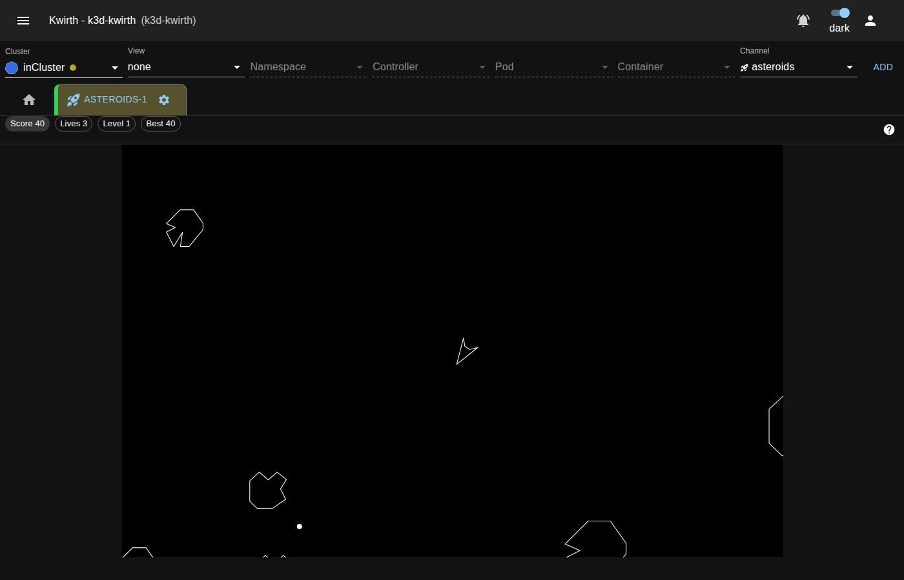
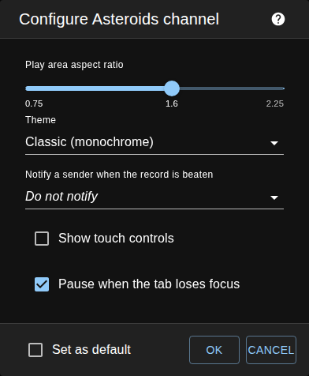
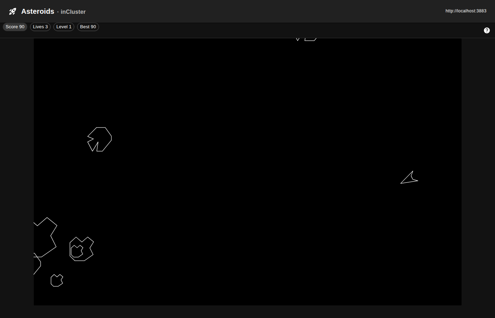
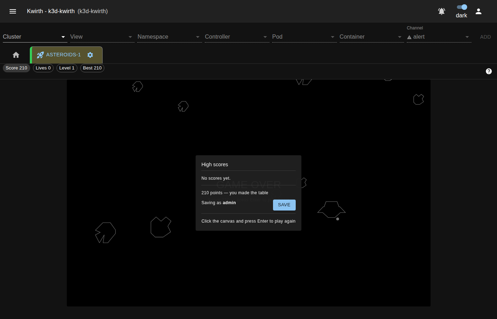

# Asteroids — a channel plugin for Kwirth

A vector asteroid shooter you play inside a [Kwirth](https://kwirthmagnify.dev) tab, in pure white on black
like the original arcade, with a high-score table shared by everyone on the cluster. Click the field, press
Enter, and turn, thrust and fire until the rocks get you.



- Kwirth: https://kwirthmagnify.dev — source at https://github.com/kwirthmagnify/kwirth
- Plugin source: https://github.com/jfvilas/kwirth (folder `plugins/asteroids`)
- License: MIT. The game core is an adapted copy of [wuspy/asteroids](https://github.com/wuspy/asteroids),
  MIT — see `NOTICE.md` and `LICENSE.upstream`.

## What it is

A **standalone channel**: it reads nothing of the cluster, asks for no cluster scope and selects no pods.
Picking it switches the view to `none` on its own. The game runs entirely in the browser; the back end only
keeps the high-score table.

The game **survives tab switches**: go to another Kwirth tab and come back, and the ship is where it was,
with its score and its lives. The game lives in the channel's data, which Kwirth keeps outside React's
render tree; the tab only holds the canvas, the animation loop and the keyboard, and rebuilds them when it
is shown again.

| Kwirth | Asteroids |
|---|---|
| Start | Creates the game, or restarts it if it was over |
| Pause | Freezes the game (it is still drawn) |
| Resume | Goes on |
| Stop | Discards the game; the high scores stay |

## Using it

Add the **asteroids** channel to a tab and start it. The setup asks for:

| Field | Meaning |
|---|---|
| **Play area aspect ratio** | 0.75 to 2.25, the shape of the field |
| **Theme** | **Classic (monochrome)**, pure white on black like the vector original, or **Color**, which tells the ship, the rocks, the saucer and the shots apart |
| **Notify a sender when the record is beaten** | Optional: one of Kwirth's senders gets a message when someone takes the top of the table |
| **Show touch controls** | On-screen buttons, for a touch screen |
| **Pause when the tab loses focus** | The game freezes when you click elsewhere, and goes on when you click it again |

The bar above the field shows the score, the lives, the level and the best score.

**Controls** (click the field first: the keyboard is the tab's, never the window's, so it does not steal
keys from Kwirth or from other tabs):

| Key | Action |
|---|---|
| Left arrow / A | Turn left |
| Right arrow / D | Turn right |
| Up arrow / W | Thrust |
| Space | Fire |
| Shift / H | Hyperspace |
| Enter | Start a game |
| Ctrl+Shift+Enter | Kwirth's full screen, where the channel shows its own bar with its name and the cluster |

## The high-score table

It lives in the cluster, not in the browser: the back end stores it in a ConfigMap,
`kwirth-store-channel-asteroids-scores`, so every user of that Kwirth sees the same table and it survives
changing machines. When a game ends with a score that makes the table, the panel offers to save it under
your Kwirth user.

It travels over the tab's websocket, not an HTTP endpoint. The front sends **one entry**, never the whole
table: its copy may be stale, and overwriting it would erase other people's games. The back inserts, sorts,
trims and tells every open tab. Writes are serialized in the process; with several Kwirth replicas a
simultaneous save can still be lost, which for a high-score table is acceptable. Without a socket it falls
back to the browser's `localStorage`.

## Installing it in Kwirth

Asteroids is published on npmjs and listed in the jfvilas marketplace:

| Artifact | Package | Installed from |
|---|---|---|
| The channel | `@jfvilas/kwirth-plugin-asteroids` | the plugin manager |
| Its guide | `@jfvilas/kwirth-docs-asteroids` | the docs manager |
| Its login page (optional) | `@jfvilas/kwirth-login-asteroids` | the login manager |

If your Kwirth does not list the jfvilas marketplace yet, add it with this manifest URL:

```
https://raw.githubusercontent.com/jfvilas/kwirth/master/manifest.json
```

Then install `asteroids` from the plugin manager. No restart is needed and it depends on no other
extension. The guide is what makes the **?** button of the tab and of the setup work.

## Technical details

- **Real silhouettes, not collision boxes.** The hit areas are the real models: four distinct asteroids with
  10 to 12 vertices, the saucer with its dome and the ship with its rear notch.
- **Canvas 2D, not WebGL.** Rescaling or moving a 2D context never loses it, which is exactly what breaks
  this use case with WebGL.
- **No WebAssembly, no Pixi.** The original core used `@pixi/core` only for geometry; a 130-line local shim
  replaces it (see `NOTICE.md`). The front bundle is around 87 KB unminified.

Known limitations: no explosions (the core does not generate the debris), no sound, no gamepad, and no
anti-cheat — the back sanitizes an entry but trusts the score the browser sends, which is fine for a team
table.

## Screenshots

The setup:



Full screen, with the channel's own bar:



Game over, with a score that makes the table:



## Building

```
npm install
npm run build      # typecheck + dist/, then the guide's docs/asteroids.tgz
npm run watch      # fast rebuild without typecheck
npm test           # unit tests
```

The e2e (`e2e/`, Playwright) runs against a live Kwirth with its own `.creds.json`;
`tests/zz-readme.spec.ts` takes the screenshots of this README.
