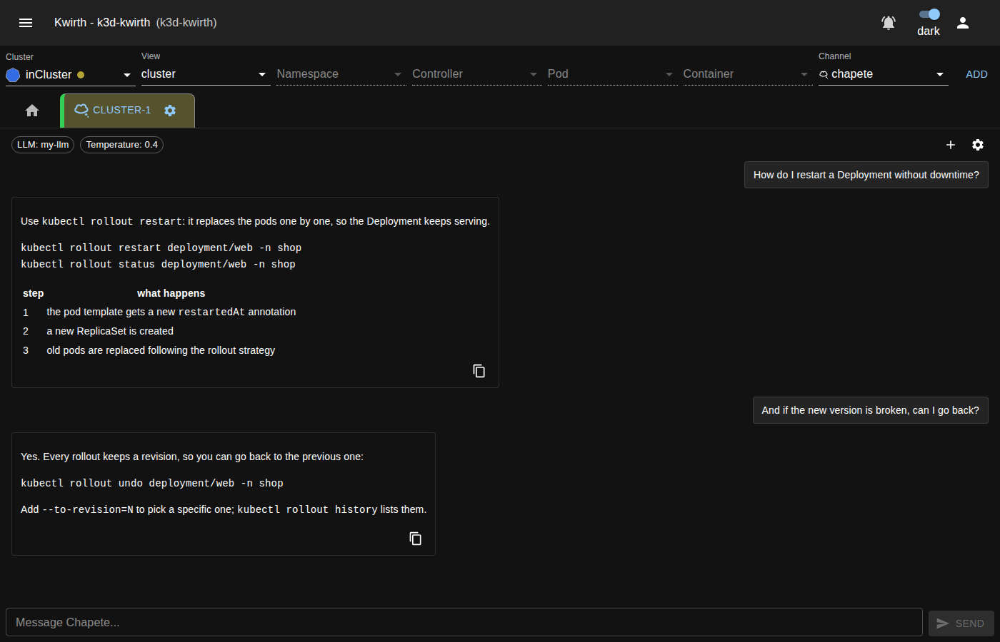
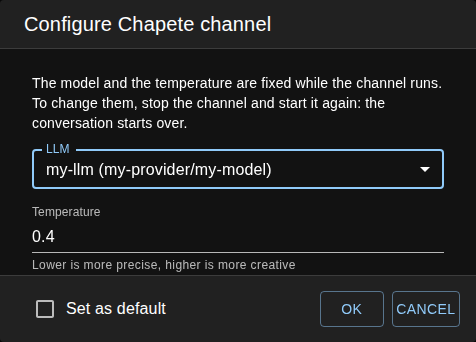
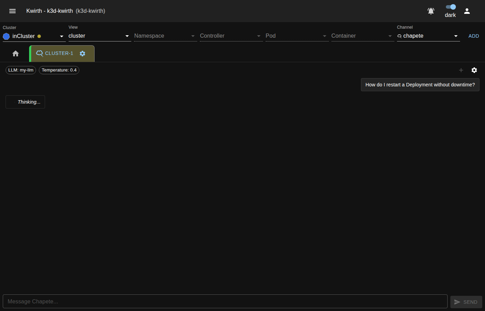
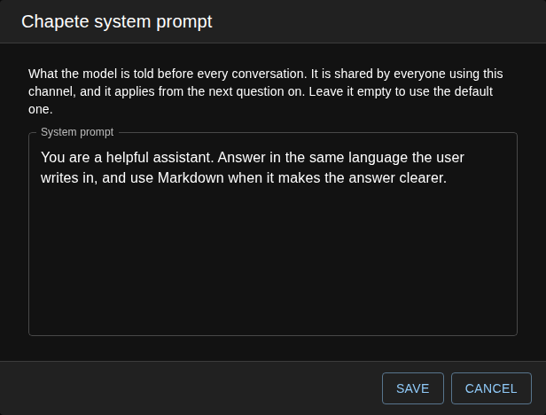

# Chapete — a channel plugin for Kwirth

A plain chat with a large language model inside a [Kwirth](https://kwirthmagnify.dev) tab: a text box, the
conversation and the answers, like ChatGPT or Claude. Pick one of the LLMs your Kwirth already has, type
your question and read the answer rendered as Markdown — code blocks, tables and lists included.



- Kwirth: https://kwirthmagnify.dev — source at https://github.com/kwirthmagnify/kwirth
- Plugin source: https://github.com/jfvilas/kwirth (folder `plugins/chapete`)
- npm: `@jfvilas/kwirth-plugin-chapete`

## What it is

Chapete does **not** bring its own AI configuration. It uses the providers and LLMs the Kwirth
administrator already set up in Kwirth's AI settings, so:

- the API keys stay in the Kwirth back end and never reach the browser;
- every question goes through Kwirth's AI usage limits, like any other AI call in Kwirth: when a limit is
  reached, the conversation says so instead of the answer.

It is a **cluster** channel: it hangs from the cluster, not from a pod, and reads nothing of it. It has no
tools; for a chat that knows your Kubernetes, look at Kwirth's other AI channels.

The conversation lives only in the tab: switching to another tab and back keeps it, but stopping and
starting the channel, or **New chat**, starts a new one.

## Using it

Open a tab with the **cluster** view and the **chapete** channel, and start it. The setup asks for:

| Field | Meaning |
|---|---|
| **LLM** | One of the LLMs configured in Kwirth. Fixed while the channel runs |
| **Temperature** | 0 to 2. It starts at the LLM's own temperature; lower is more precise, higher is more creative |

To change either, stop the channel and start it again: the conversation starts over.

In the tab:

| Control | Does |
|---|---|
| **Enter** | Sends the question |
| **Shift+Enter** | A new line in the question, without sending it |
| **Copy** (under an answer) | Copies the answer's Markdown |
| **+** (New chat) | Empties the conversation; the next question starts from scratch |
| **⚙** (System prompt) | What the model is told before every conversation |

The model gets the whole conversation on every turn, so it keeps the context. While it works, the tab
shows *Thinking...* and the message box waits; a provider error is shown in the conversation and is not
sent back to the model on the next turn.

**The system prompt** is one for the whole channel, shared by everyone using it, and it applies from the
next question on. Left empty, Chapete uses its default one: answer in the user's language, and use
Markdown when it makes the answer clearer.

## Installing it in Kwirth

It is published on npmjs as `@jfvilas/kwirth-plugin-chapete` and listed in the jfvilas marketplace. If
your Kwirth does not list it yet, add it as a marketplace with this manifest URL:

```
https://raw.githubusercontent.com/jfvilas/kwirth/master/manifest.json
```

Then install `chapete` from the plugin manager. No restart is needed. It needs at least one **AI
provider** and one **LLM** configured in Kwirth's AI settings; without them the setup says where to
configure them and does not let the channel start.

## Screenshots

The setup, with the LLM and the temperature:



*Thinking...* while the model works:



The channel's system prompt:



## Building

```
npm install
npm run build      # typecheck + dist/
npm test           # unit tests; COVERAGE=1 npm test for c8 coverage
```

The e2e (`e2e/`, Playwright) runs against a live Kwirth with its own `.creds.json`. It adds a fake
OpenAI-compatible provider and LLM to the AI settings and removes them at the end, so no real LLM is ever
called; `tests/zz-capture.spec.ts` takes the screenshots of this README the same way.
