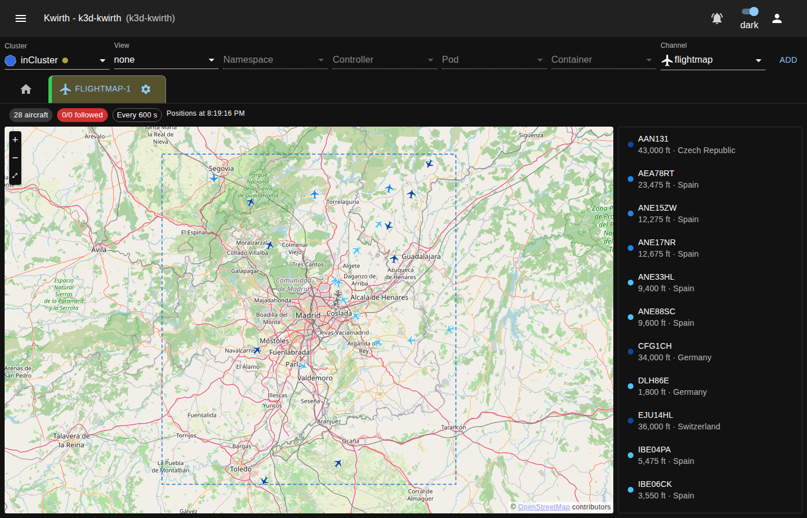
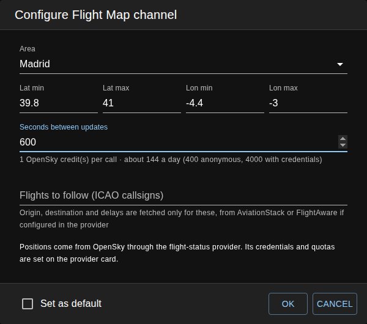
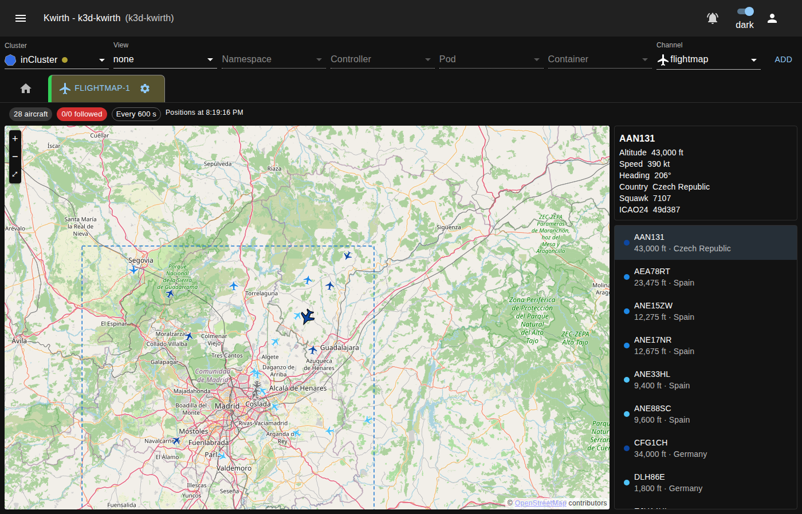

# Flight Map — a channel plugin for Kwirth

The aircraft flying over an area, live on a map inside a [Kwirth](https://kwirthmagnify.dev) tab: every plane
pointing along its track and coloured by altitude, a list beside the map, and route and delays for the
flights you follow.



- Kwirth: https://kwirthmagnify.dev — source at https://github.com/kwirthmagnify/kwirth
- Plugin source: https://github.com/jfvilas/kwirth (folder `plugins/flightmap`)
- npm: `@jfvilas/kwirth-plugin-flightmap`
- Map tiles © [OpenStreetMap](https://www.openstreetmap.org/copyright) contributors

## What it is

Flight Map draws; it does not fetch. The data comes from the **flight-status provider**
(`@jfvilas/kwirth-provider-flight-status`), which gets the positions from [OpenSky](https://opensky-network.org)
and the flight details from AviationStack or FlightAware, keeping their quotas in check. Flight Map subscribes
to it on behalf of each tab, with that tab's area, interval and followed flights, and the provider sends each
tab only what it asked for.

It is a **standalone channel**: it reads nothing of the cluster and asks for no cluster scope. Picking it
switches the view to `none` on its own, and the tab is named after the channel.

## Using it

Add the **flightmap** channel to a tab and start it. The setup asks for:

| Field | Meaning |
|---|---|
| **Area** | A ready-made area — Iberian peninsula, Madrid, Barcelona, Canary Islands, Balearic Islands — or **Custom** |
| **Lat min / Lat max / Lon min / Lon max** | The box, in degrees. Editing a corner switches the area to Custom |
| **Seconds between updates** | At least 10. Under it, what the setup costs in OpenSky credits per call and per day, against the daily quota (400 anonymous, 4000 with credentials) |
| **Flights to follow** | ICAO callsigns, like `IBE3171`. Only for these are origin, destination and delays fetched |

The bar above the map says how many aircraft there are, how many of the followed flights are in the area,
the interval and when the last positions arrived. In the map:

- each aircraft points along its track, coloured by altitude, and grey when it is on the ground;
- the followed flights are highlighted and listed first, with origin, destination, schedule and delays — or
  *Not in the area right now*;
- clicking an aircraft, on the map or in the list, shows its altitude, speed, heading, country, squawk and
  ICAO24 address;
- drag to move, mouse wheel to zoom, and one button to see the whole area again.

A provider error (a spent quota, for instance) is shown above the map, and the last positions stay on it
until the next ones arrive.

## Installing it in Kwirth

It is published on npmjs as `@jfvilas/kwirth-plugin-flightmap` and listed in the jfvilas marketplace. If your
Kwirth does not list it yet, add it as a marketplace with this manifest URL:

```
https://raw.githubusercontent.com/jfvilas/kwirth/master/manifest.json
```

1. From the **provider manager**, install **Flight Status Provider** and restart Kwirth. Your own OpenSky,
   AviationStack and FlightAware credentials go on its card; all are optional.
2. From the **plugin manager**, install `flightmap`. No restart is needed.

The cluster needs outbound access to OpenSky (and to AviationStack or FlightAware, if configured), and your
browser to `tile.openstreetmap.org`.

## Screenshots

The setup, with the Madrid area and its cost:



An aircraft selected:



## Building

```
npm install
npm run build      # typecheck + dist/
npm test           # unit tests; COVERAGE=1 npm test for c8 coverage
```

The e2e (`e2e/`, Playwright) runs against a live Kwirth with its own `.creds.json`. It feeds the map with
injected positions, so it spends no OpenSky credits; `tests/zz-readme.spec.ts` takes the screenshots of this
README with real data instead (one call for the Madrid area). The guide is in [docs/guide](docs/guide/guide.md).
