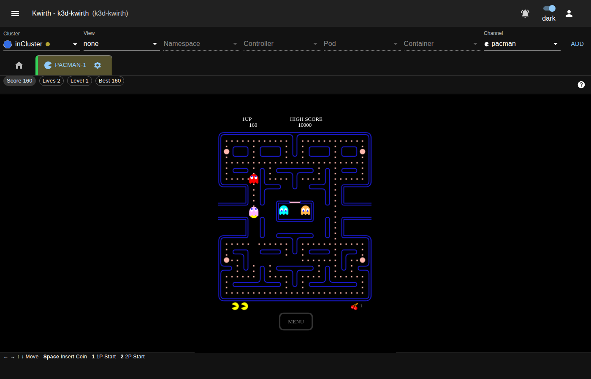
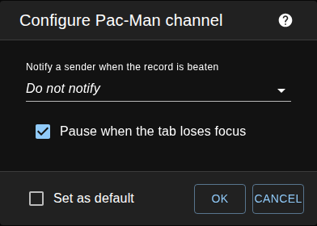
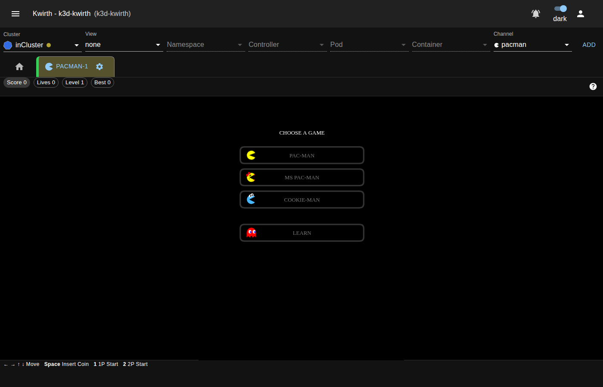
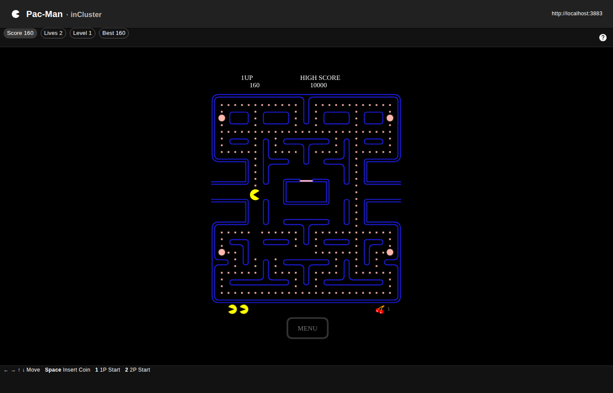

# Pac-Man — a channel plugin for Kwirth

The classic Pac-Man arcade game, playable inside a [Kwirth](https://kwirthmagnify.dev) tab — with Ms. Pac-Man
and Cookie-Man too — and a high-score table shared by everyone on the cluster. Click the game, pick one,
and eat the dots before the ghosts eat you.



- Kwirth: https://kwirthmagnify.dev — source at https://github.com/kwirthmagnify/kwirth
- Plugin source: https://github.com/jfvilas/kwirth (folder `plugins/pacman`)
- License: **GPL v3**. The game is a reimplementation by Shaun Williams, distributed under the GPL v3, and so
  is this plugin, which bundles it. See `NOTICE.md` and `LICENSE.upstream` (both shipped in the package).

## What it is

A **standalone channel**: it reads nothing of the cluster, asks for no cluster scope and selects no pods.
Picking it switches the view to `none` on its own.

The game runs entirely in the browser, inside an iframe, so its globals never clash with Kwirth's. The back
end only keeps the high-score table. The game **survives tab switches**: the iframe lives in the channel's
data, outside React's render tree, and is only moved over the tab when it is shown and hidden when it is
not. Only stopping the channel destroys it.

## Using it

Add the **pacman** channel to a tab and start it. The setup asks for:

| Field | Meaning |
|---|---|
| **Notify a sender when the record is beaten** | Optional: one of Kwirth's senders gets a message when someone takes the top of the table |
| **Pause when the tab loses focus** | The game freezes when you click elsewhere, and goes on when you click it again |

The game opens on its own menu: **Pac-Man**, **Ms. Pac-Man**, **Cookie-Man**, and **Learn**, which shows how
each ghost hunts. The bar above it shows the score, the lives, the level and the best score.

| Key | Action |
|---|---|
| Arrows | Move (and choose in the menus) |
| Enter | Pick a menu entry |
| Space | Insert coin |
| 1 / 2 | Start a one- or two-player game |
| Ctrl+Shift+Enter | Kwirth's full screen, also while the game has the focus |

The game keeps the arcade's 224:288 proportions and fits the tab. It references sound files that are **not
included** (about 1.8 MB of MP3s): it plays without them, in silence.

## The high-score table

It lives in the cluster, not in the browser: the back end stores it in a ConfigMap,
`kwirth-store-channel-pacman-scores`, so every user of that Kwirth sees the same table and it survives
changing machines. Without a socket it falls back to the browser's `localStorage`.

## Installing it in Kwirth

It is published on npmjs as `@jfvilas/kwirth-plugin-pacman` and listed in the jfvilas marketplace. If your
Kwirth does not list it yet, add it as a marketplace with this manifest URL:

```
https://raw.githubusercontent.com/jfvilas/kwirth/master/manifest.json
```

Then install `pacman` from the plugin manager. No restart is needed and it depends on no other extension.
Its guide, `@jfvilas/kwirth-docs-pacman`, installs from the docs manager and makes the **?** buttons work.

## Screenshots

The setup:



The game's own menu:



Full screen:



## Building

```
npm install
npm run build      # typecheck + dist/, then the guide's docs/pacman.tgz
npm run watch      # fast rebuild without typecheck
npm test           # unit tests
```

The e2e (`e2e/`, Playwright) runs against a live Kwirth with its own `.creds.json`;
`tests/zz-readme.spec.ts` takes the screenshots of this README.
