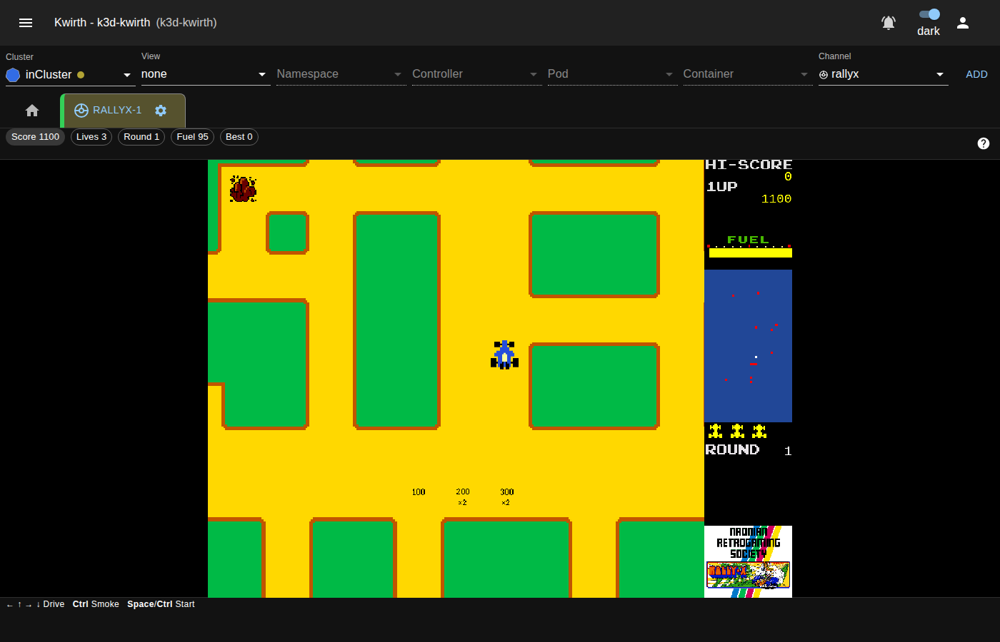
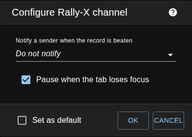
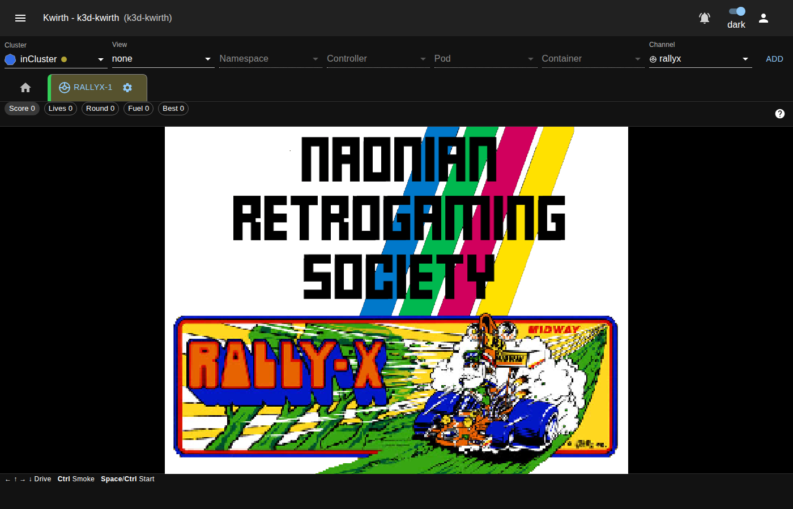
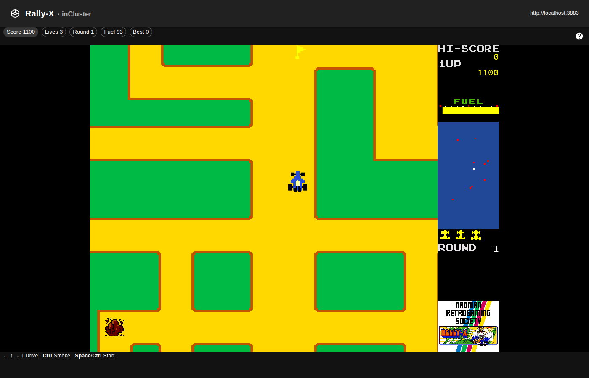

# Rally-X — a channel plugin for Kwirth

A Rally-X arcade game inside a [Kwirth](https://kwirthmagnify.dev) tab: drive your blue car through the maze,
pick up the flags before the fuel runs out, and lose the red cars behind a cloud of smoke. A homebrew
recreation of the 1980 arcade classic, with a high-score table shared by everyone on the cluster.



- Kwirth: https://kwirthmagnify.dev — source at https://github.com/kwirthmagnify/kwirth
- Plugin source: https://github.com/jfvilas/kwirth (folder `plugins/rallyx`)
- The game is MIT licensed, Copyright (c) 2017 Marco Parenzan; see [NOTICE.md](NOTICE.md).

## What it is

A **standalone channel**: it reads nothing of the cluster, asks for no cluster scope and selects no pods.
Picking it switches the view to `none` on its own.

The game is built with Phaser 2 and runs in an isolated iframe, so its globals never clash with Kwirth's.
Phaser, RequireJS and every asset travel inside the plugin's `front.js`, so it needs no network once
installed. The iframe **survives tab switches**: switching away hides it, coming back puts it in place again,
and only stopping the channel destroys it. A small bridge reports the game's state to the tab, which shows
it in the bar above the game: score, lives, round, fuel and best score.

## Using it

Add the **rallyx** channel to a tab and start it. The setup asks for:

| Field | Meaning |
|---|---|
| **Notify a sender when the record is beaten** | Optional: one of Kwirth's senders gets a message when someone takes the top of the table |
| **Pause when the tab loses focus** | The game freezes when you click elsewhere, and goes on when you click it again |

| Key | Action |
|---|---|
| Arrows | Drive |
| Ctrl | Smoke screen |
| Space / Ctrl | Start, on the title screen |
| Ctrl+Shift+Enter | Kwirth's full screen, also while the game has the focus |

The game keeps its 4:3 proportions and fits the tab.

## The high-score table

It lives in the cluster, not in the browser: the back end stores it in a ConfigMap,
`kwirth-store-channel-rallyx-scores`, so every user of that Kwirth sees the same table and it survives
changing machines.

## Installing it in Kwirth

It is published on npmjs as `@jfvilas/kwirth-plugin-rallyx` and listed in the jfvilas marketplace. If your
Kwirth does not list it yet, add it as a marketplace with this manifest URL:

```
https://raw.githubusercontent.com/jfvilas/kwirth/master/manifest.json
```

Then install `rallyx` from the plugin manager. No restart is needed and it depends on no other extension.

## Screenshots

The setup:



The title screen:



Full screen:



## Building

```
npm install
npm run build      # typecheck + dist/
npm run watch      # fast rebuild without typecheck
npm test           # unit tests
```

The e2e (`e2e/`, Playwright) runs against a live Kwirth with its own `.creds.json`;
`tests/zz-readme.spec.ts` takes the screenshots of this README.

```
src/
├── back/index.ts            back channel: the score table (ConfigMap)
├── common/RallyxTypes.ts    shared types
└── front/
    ├── RallyxChannel.tsx    the channel: lifecycle and messages
    ├── RallyxMachine.ts     the iframe: builds its HTML, keeps it alive
    ├── RallyxTabContent.tsx the tab: HUD, game area, score panel
    ├── RallyxSetup.tsx      the setup dialog
    ├── RallyxScores.ts      the score store (back, with a local fallback)
    └── rallyx/              Phaser, RequireJS, the game modules and its assets
```
