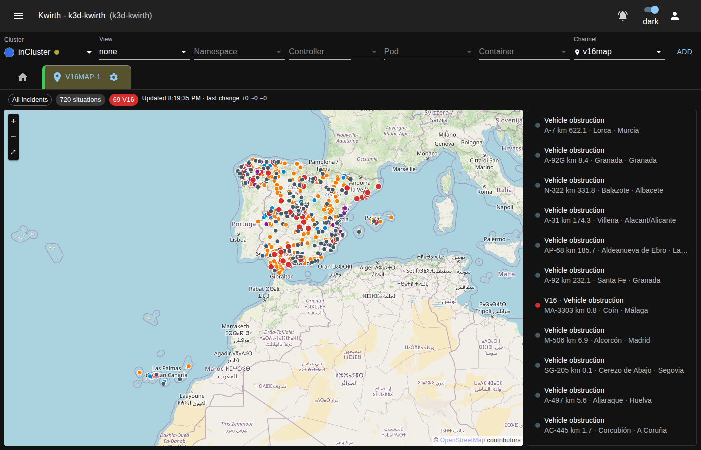
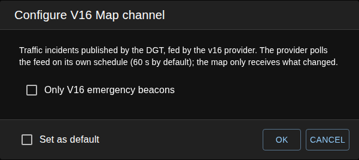
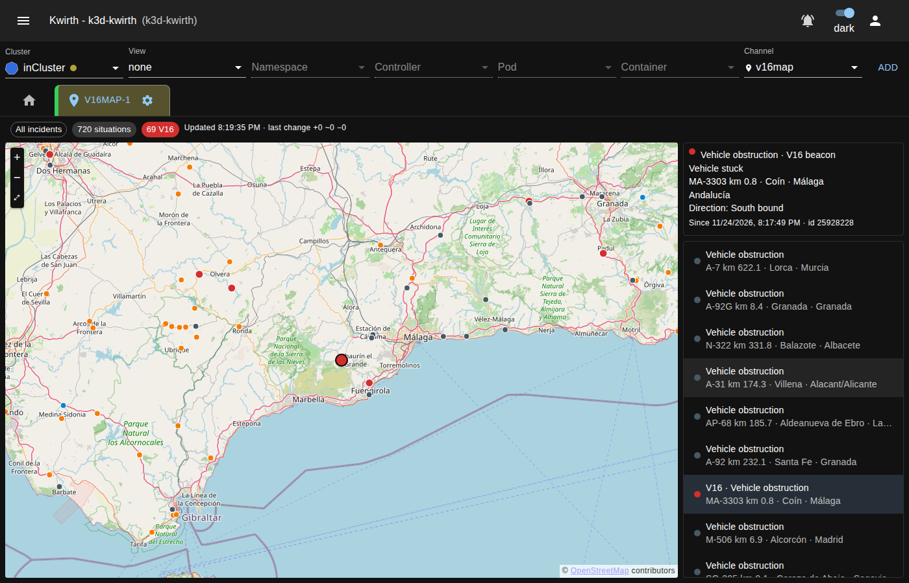

# V16 Map — a channel plugin for Kwirth

The traffic incidents published by Spain's DGT, live on a map inside a [Kwirth](https://kwirthmagnify.dev) tab,
with the **V16 emergency beacons** in red: the light a driver switches on, since 2026, instead of walking out
with the warning triangles.



- Kwirth: https://kwirthmagnify.dev — source at https://github.com/kwirthmagnify/kwirth
- Plugin source: https://github.com/jfvilas/kwirth (folder `plugins/v16map`)
- npm: `@jfvilas/kwirth-plugin-v16map`
- Map tiles © [OpenStreetMap](https://www.openstreetmap.org/copyright) contributors

## What it is

V16 Map draws; it does not fetch. The data comes from the **v16 provider** (`@jfvilas/kwirth-provider-v16`),
which polls the DGT's DATEX2 feed on its own schedule (every 60 seconds by default) and works out what
changed. V16 Map subscribes to it on behalf of each tab: the tab gets the whole picture once, and after that
only what was added, updated or cleared.

It is a **standalone channel**: it reads nothing of the cluster and asks for no cluster scope. Picking it
switches the view to `none` on its own, and the tab is named after the channel.

## Using it

Add the **v16map** channel to a tab and start it. The setup asks for one thing:

| Field | Meaning |
|---|---|
| **Only V16 emergency beacons** | Off: every incident in the feed. On: only those raised by a V16 beacon |

The bar above the map says how many incidents there are, how many of them are V16 beacons, and when the last
update arrived with what it brought (`+added ~updated −cleared`). In the map:

- every incident in force, coloured by its cause; the V16 beacons in red;
- a list beside the map, newest first; incidents the feed gives no position for are listed too;
- clicking an incident, on the map or in the list, shows its cause and detail, road and kilometre, town,
  province and region, direction, start time and DGT id;
- drag to move, mouse wheel to zoom, and one button to see the whole country again.

## Installing it in Kwirth

It is published on npmjs as `@jfvilas/kwirth-plugin-v16map` and listed in the jfvilas marketplace. If your
Kwirth does not list it yet, add it as a marketplace with this manifest URL:

```
https://raw.githubusercontent.com/jfvilas/kwirth/master/manifest.json
```

1. From the **provider manager**, install **V16 Provider** and restart Kwirth.
2. From the **plugin manager**, install `v16map`. No restart is needed.

The cluster needs outbound access to the DGT feed, and your browser to `tile.openstreetmap.org`.

## Screenshots

The setup:



A V16 beacon selected:



## Building

```
npm install
npm run build      # typecheck + dist/
npm test           # unit tests; COVERAGE=1 npm test for c8 coverage
```

The e2e (`e2e/`, Playwright) runs against a live Kwirth with its own `.creds.json`. It feeds the map with
injected incidents (and checks once that the real provider answers); `tests/zz-readme.spec.ts` takes the
screenshots of this README with the real feed. The guide is in [docs/guide](docs/guide/guide.md).
