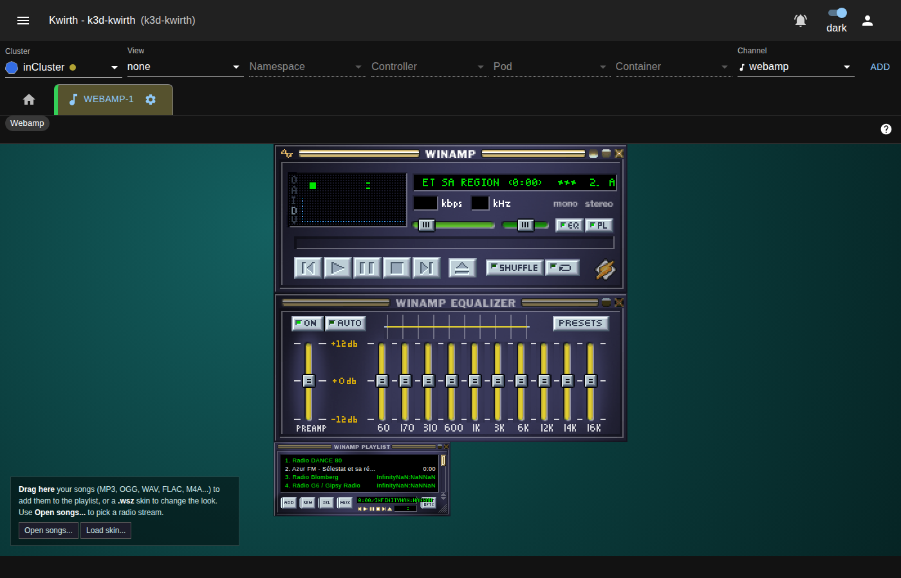
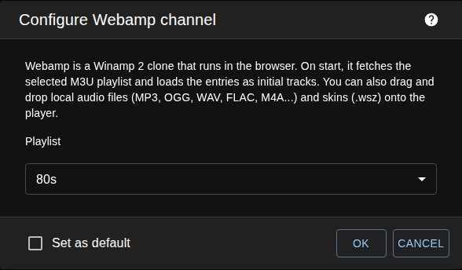
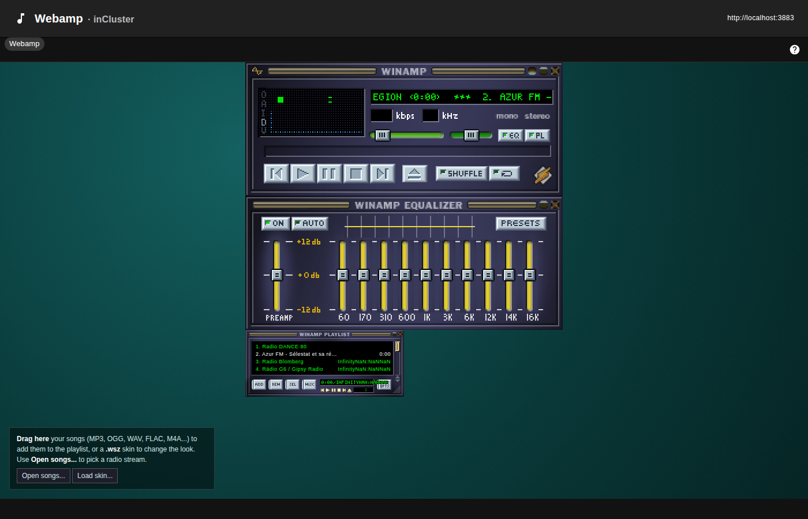

# Webamp — a channel plugin for Kwirth

Winamp 2 inside a [Kwirth](https://kwirthmagnify.dev) tab, powered by [Webamp](https://github.com/captbaritone/webamp),
Jordan Eldredge's Winamp in JavaScript. It starts with a playlist of internet radio stations already loaded,
and you can drop your own songs and skins onto it.



- Kwirth: https://kwirthmagnify.dev — source at https://github.com/kwirthmagnify/kwirth
- Plugin source: https://github.com/jfvilas/kwirth (folder `plugins/webamp`)
- Webamp is MIT licensed (full text in `LICENSE.webamp`, shipped in the package). Version included:
  webamp@2.3.1.

## What it is

A **standalone channel**: it reads nothing of the cluster, asks for no cluster scope and selects no pods.
Picking it switches the view to `none` on its own. It keeps nothing in the back end either: the player lives
in your browser.

Webamp (about 940 KB) travels inside the plugin's `front.js` and runs in an isolated iframe, so its globals
never clash with Kwirth's. The player **survives tab switches**: the iframe lives in the channel's data,
outside React's render tree, so the music keeps playing while you look at another tab. The Milkdrop
visualizer is not included: it needs WebAssembly, and this build is plain JavaScript.

## Using it

Add the **webamp** channel to a tab and start it. The setup asks for one thing:

| Field | Meaning |
|---|---|
| **Playlist** | An M3U playlist of internet radio stations, from the [junguler/m3u-radio-music-playlists](https://github.com/junguler/m3u-radio-music-playlists) repository: 80s, jazz, rock… If the list cannot be fetched, the 80s playlist is used |

On start, the player fetches that playlist and loads its stations as tracks. Then, as in Winamp:

- double-click a station, or press Play, to listen to it;
- drag and drop your own audio files (MP3, OGG, WAV, FLAC, M4A…) onto the player to add them to the playlist,
  or use **Open songs…**;
- drag and drop a `.wsz` skin, or use **Load skin…**, to change its look — the
  [Winamp Skin Museum](https://skins.webamp.org) has thousands;
- right-click the player for its options menu; Winamp's hotkeys (Z, X, C, V, B…) work too.

**Ctrl+Shift+Enter** puts the tab in Kwirth's full screen, also while the player has the focus.

## Installing it in Kwirth

It is published on npmjs as `@jfvilas/kwirth-plugin-webamp` and listed in the jfvilas marketplace. If your
Kwirth does not list it yet, add it as a marketplace with this manifest URL:

```
https://raw.githubusercontent.com/jfvilas/kwirth/master/manifest.json
```

Then install `webamp` from the plugin manager. No restart is needed and it depends on no other extension.
Its guide, `@jfvilas/kwirth-docs-webamp`, installs from the docs manager and makes the **?** buttons work.
Your browser needs to reach GitHub (for the playlists) and the radio stations themselves.

## Screenshots

The setup, with the playlist:



Full screen:



## Building

```
npm install
npm run build      # typecheck + dist/, then the guide's docs/webamp.tgz
npm run watch      # fast rebuild without typecheck
npm test           # unit tests
```

The e2e (`e2e/`, Playwright) runs against a live Kwirth with its own `.creds.json`;
`tests/zz-readme.spec.ts` takes the screenshots of this README.

## Credits

Webamp by Jordan Eldredge ([github.com/captbaritone/webamp](https://github.com/captbaritone/webamp)), MIT license.
